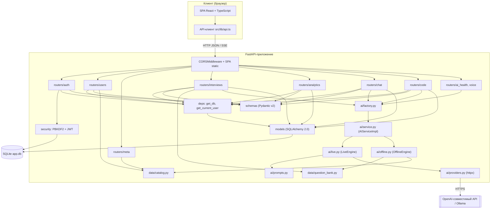
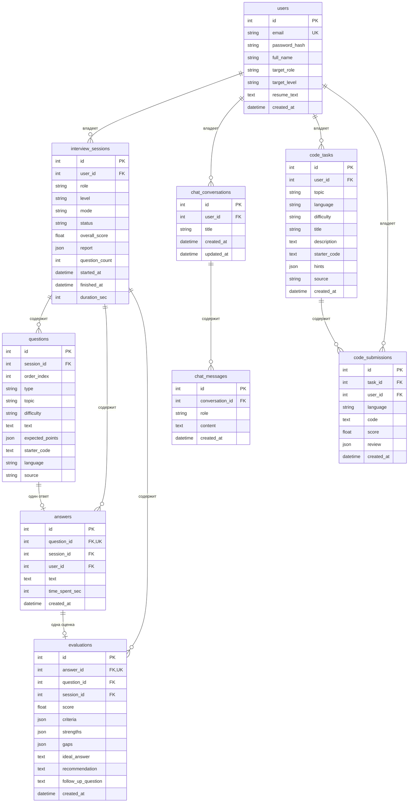
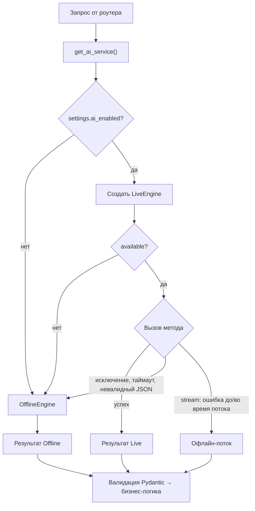
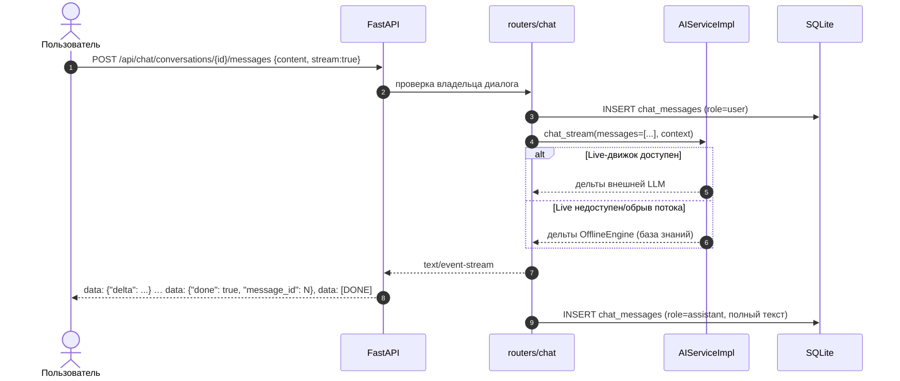
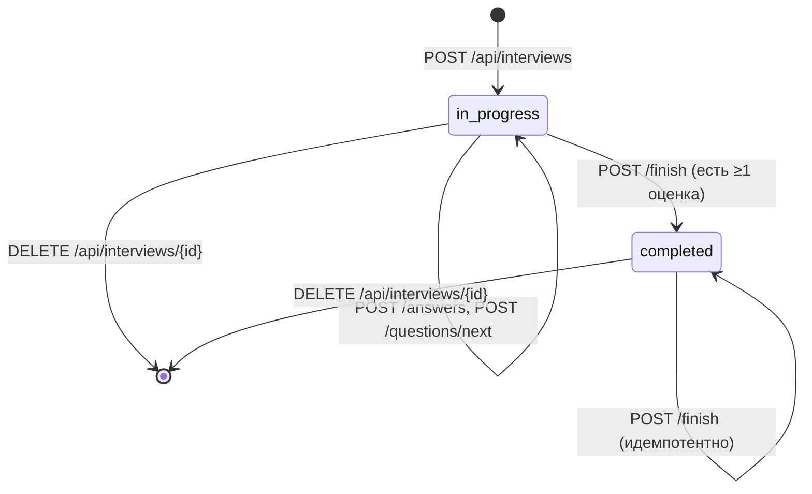

# 02. Архитектура системы

**Проект:** «Интеллектуальный тренажёр для подготовки к собеседованиям»
**Версия документа:** 1.0
**Связанные документы:** [Техническое задание](01-ТЗ.md), [API-контракт](API.md), [Сценарии](03-Сценарии.md), [Пояснительная записка](04-ПЗ.md)

## 1. Общая характеристика архитектуры

Система построена по трёхуровневой схеме «клиент — сервер приложений — данные»
с выделенным внутри сервера приложений слоем интеграции с большими языковыми
моделями (LLM). Архитектурный стиль — модульный монолит: единый развёртываемый
артефакт (процесс `uvicorn`), внутри которого функциональность разделена на
независимые модули (роутеры, ИИ-слой, справочники) с жёстко зафиксированным
контрактом взаимодействия.

Ключевые архитектурные решения:

1. **Один процесс для API и SPA.** Собранный React-бандл размещается в
   `backend/app/static` и раздаётся тем же FastAPI-приложением. Это устраняет
   необходимость в отдельном веб-сервере и упрощает развёртывание и демонстрацию.
2. **Провайдер-агностичный ИИ-слой.** Все интеллектуальные операции объявлены
   абстракцией `AIService` (`backend/app/ai/base.py`). Роутеры обращаются только
   к фабрике `get_ai_service()` и не знают, какая модель отвечает — внешняя LLM
   или локальный офлайн-движок.
3. **Обязательный офлайн-режим.** Offline-движок создаётся при старте и является
   основным запасным путём для каждого метода ИИ-сервиса. Полный пользовательский
   сценарий не зависит от доступности внешнего API; сбой инициализации офлайн-
   движка логируется как критическая ошибка.
4. **Контракт-first.** `docs/API.md` — единый источник истины; Pydantic-схемы
   (`schemas.py`) и TypeScript-типы фронтенда выводятся из него. Расхождение кода
   и контракта считается дефектом.
5. **Stateless-аутентификация.** JWT в заголовке `Authorization: Bearer` — сервер
   не хранит сессии; состояние пользователя восстанавливается из токена и БД.

## 2. Логическая архитектура

### 2.1. Слои

```text
┌───────────────────────────────────────────────────────────────────────────┐
│                        КЛИЕНТСКИЙ СЛОЙ (браузер)                          │
│  React 18 + TypeScript + Vite + TailwindCSS                               │
│  страницы: /login /register / (дашборд) /interview/new /interview/:id     │
│            /chat /code /history /profile                                  │
│  слой доступа к API: src/lib/api.ts (JWT из localStorage, обработка 401)   │
└───────────────────────────────────┬───────────────────────────────────────┘
                                    │ HTTPS/HTTP, JSON, SSE
                                    ▼
┌───────────────────────────────────────────────────────────────────────────┐
│                      СЕРВЕР ПРИЛОЖЕНИЙ (FastAPI)                          │
│                                                                           │
│  ┌─ Транспорт и сквозные функции ─────────────────────────────────────┐   │
│  │ CORSMiddleware · раздача SPA (static) · обработка ошибок · logging │   │
│  └────────────────────────────────────────────────────────────────────┘   │
│  ┌─ Слой API (роутеры, /api/*) ───────────────────────────────────────┐   │
│  │ auth · users · meta · interviews · analytics · chat · code ·       │   │
│  │ ai_health · voice                                                  │   │
│  └────────────────────────────────────────────────────────────────────┘   │
│  ┌─ Слой прикладной логики ───────────────────────────────────────────┐   │
│  │ сценарии сессии интервью, расчёт отчёта, адаптивный подбор вопроса, │   │
│  │ агрегация аналитики, жизненный цикл диалогов и код-ревью            │   │
│  └────────────────────────────────────────────────────────────────────┘   │
│  ┌─ Слой доступа к данным (SQLAlchemy 2.0 ORM) ───────────────────────┐   │
│  │ модели User, InterviewSession, Question, Answer, Evaluation,       │   │
│  │ ChatConversation, ChatMessage, CodeTask, CodeSubmission            │   │
│  └────────────────────────────────────────────────────────────────────┘   │
│  ┌─ ИИ-слой ──────────────────────────────────────────────────────────┐   │
│  │ AIService (контракт) ← AIServiceImpl (фабрика + fallback)          │   │
│  │        ├── LiveEngine   (LLM по HTTP, поток, Whisper)              │   │
│  │        └── OfflineEngine (банк вопросов + эвристики, без сети)      │   │
│  └────────────────────────────────────────────────────────────────────┘   │
└───────────────┬──────────────────────────────────────┬────────────────────┘
                │                                      │
                ▼                                      ▼
     ┌─────────────────────┐                ┌──────────────────────────────┐
     │  SQLite (app.db)    │                │ Внешняя LLM (опционально)    │
     │  9 таблиц, JSON-    │                │ OpenAI / OpenRouter /        │
     │  поля для снимков   │                │ DeepSeek / Ollama            │
     └─────────────────────┘                └──────────────────────────────┘
```

### 2.2. Диаграмма компонентов



### 2.3. Компоненты и зоны ответственности

| Компонент | Файлы | Ответственность |
|---|---|---|
| Точка входа | `app/main.py` | Создание `FastAPI`, подключение роутеров, CORS, раздача SPA, `init_db()` при старте, служебный `GET /api/health` |
| Конфигурация | `app/config.py` | `Settings` (pydantic-settings): имя, версия, БД, JWT, CORS, параметры ИИ, каталог статики; свойство `ai_enabled` |
| Доступ к данным | `app/db.py` | `Base`, `engine`, `SessionLocal`, `get_db()`, идемпотентный `init_db()` |
| Модели | `app/models.py` | 9 ORM-моделей, каскады, JSON-поля, `utcnow()` |
| Схемы | `app/schemas.py` | Pydantic v2-схемы запросов/ответов, ограничения полей, литеральные типы кодов |
| Безопасность | `app/security.py` | PBKDF2-SHA256-хеширование, `create_access_token`, `decode_token` |
| Зависимости | `app/deps.py` | `get_current_user` через `HTTPBearer(auto_error=False)`, `401` с `WWW-Authenticate` |
| API-роутеры | `app/routers/*.py` | Валидация входа, проверка владельца, вызов ИИ/БД, формирование ответов |
| Справочники | `app/data/catalog.py` | 6 направлений с темами, 4 уровня, 3 режима, типы, сложности, нормализация кодов |
| Банк контента | `app/data/question_bank.py` | `BANK` (вопросы с `expected_points`), `CODE_TASKS`, `pick_questions`, `pick_code_task` |
| Контракт ИИ | `app/ai/base.py` | ABC `AIService`, Pydantic-модели результатов (`GeneratedQuestion`, `EvaluationResult`, `SessionReportData`, `CodeTaskData`, `CodeReviewData`, `AIHealthInfo`) |
| Фабрика ИИ | `app/ai/factory.py` | Ленивый потокобезопасный синглтон `get_ai_service()`, `reset_ai_service()` |
| Диспетчер ИИ | `app/ai/service.py` | `AIServiceImpl`: создание Live/Offline, `_dispatch` с fallback, особая логика `chat_stream`, `health`, `transcribe` |
| Live-движок | `app/ai/live.py` | Реализация `AIService` через LLM: JSON-промпты, стриминг, Whisper |
| Offline-движок | `app/ai/offline.py` | Детерминированная реализация: банк вопросов, эвристики оценки, локальный чат, эвристическое ревью |
| Промпты | `app/ai/prompts.py` | Системные промпты на русском, инструкции строгого JSON |
| HTTP-провайдер | `app/ai/providers.py` | `httpx`-клиент `POST {base_url}/chat/completions`, ретраи, `response_format`, парсер SSE, `/models`, `/audio/transcriptions` |
| Скрипты | `backend/scripts/` | `smoke_check.py` (сквозная проверка), `seed_demo.py` (демо-данные) |
| Тесты | `backend/tests/` | pytest-набор с временной SQLite и `TestClient` |

## 3. Схема базы данных

### 3.1. Перечень таблиц

| № | Таблица | Назначение | Ключевые поля |
|---|---|---|---|
| 1 | `users` | Учётные записи и цель подготовки | `id`, `email` (unique), `password_hash`, `full_name`, `target_role`, `target_level`, `resume_text`, `created_at` |
| 2 | `interview_sessions` | Попытка прохождения собеседования | `id`, `user_id` → `users.id`, `role`, `level`, `mode`, `status`, `overall_score`, `report` (JSON), `question_count`, `started_at`, `finished_at`, `duration_sec` |
| 3 | `questions` | Вопросы сессии | `id`, `session_id` → `interview_sessions.id`, `order_index`, `type`, `topic`, `difficulty`, `text`, `expected_points` (JSON), `starter_code`, `language`, `source` |
| 4 | `answers` | Ответы пользователя | `id`, `question_id` → `questions.id` (unique), `session_id`, `user_id`, `text`, `time_spent_sec`, `created_at` |
| 5 | `evaluations` | ИИ-оценки ответов | `id`, `answer_id` → `answers.id` (unique), `question_id`, `session_id`, `score`, `criteria` (JSON), `strengths` (JSON), `gaps` (JSON), `ideal_answer`, `recommendation`, `follow_up_question`, `created_at` |
| 6 | `chat_conversations` | Диалоги чат-ассистента | `id`, `user_id` → `users.id`, `title`, `created_at`, `updated_at` |
| 7 | `chat_messages` | Сообщения диалога | `id`, `conversation_id` → `chat_conversations.id`, `role` (`user`/`assistant`/`system`), `content`, `created_at` |
| 8 | `code_tasks` | Сгенерированные задачи по коду | `id`, `user_id` → `users.id`, `topic`, `language`, `difficulty`, `title`, `description`, `starter_code`, `hints` (JSON), `source`, `created_at` |
| 9 | `code_submissions` | Отправленные решения и ревью | `id`, `task_id` → `code_tasks.id` (nullable), `user_id`, `language`, `code`, `score`, `review` (JSON), `created_at` |

### 3.2. ER-диаграмма



### 3.3. Соглашения модели данных

* **Типы.** Все первичные ключи — целые (`Integer`, автоинкремент). Даты — `DateTime`
  без таймзоны в UTC (функция `utcnow()` в `models.py` сознательно снимает
  таймзону, поскольку SQLite её не хранит). Словари и списки хранятся в
  JSON-колонках (`JSON` из SQLAlchemy).
* **Ограничения целостности.** `answers.question_id` и `evaluations.answer_id`
  объявлены `unique`: на один вопрос — не более одного ответа, на один ответ —
  не более одной актуальной оценки (при повторной отправке старая оценка удаляется
  и создаётся заново). `users.email` — `unique` + индекс.
* **Каскады.** Связи `User → InterviewSession → Question/Answer`,
  `Answer → Evaluation`, `ChatConversation → ChatMessage`,
  `CodeTask → CodeSubmission` объявлены с `cascade="all, delete-orphan"`,
  поэтому удаление владельца каскадно удаляет вложенные сущности на уровне ORM.
  Внешние ключи объявлены с `ondelete="CASCADE"`.
* **Денормализация.** В `answers` и `evaluations` продублированы `session_id`
  и `user_id`/`question_id` — это позволяет строить агрегаты аналитики одним
  соединением и упрощает проверку владельца.
* **Снимки (snapshots).** `interview_sessions.report`, `evaluations.criteria`,
  `code_submissions.review` хранят результат ИИ «как есть» на момент получения.
  Повторный пересчёт отчёта возможен, но снимок сохраняет историческую оценку.
* **Инициализация схемы.** `init_db()` вызывает `Base.metadata.create_all` —
  идемпотентно создаёт отсутствующие таблицы; миграций в версии 1.0 нет.

### 3.4. Индексы

| Таблица | Индексируемые поля | Назначение |
|---|---|---|
| `users` | `email` (unique) | Поиск при входе |
| `interview_sessions` | `user_id` | Список сессий пользователя |
| `questions` | `session_id` | Загрузка вопросов сессии |
| `answers` | `question_id` (unique), `session_id` | Проверка единственности ответа, агрегация |
| `evaluations` | `answer_id` (unique), `question_id`, `session_id` | Выборка оценок для отчёта и аналитики |
| `chat_conversations` | `user_id` | Список диалогов |
| `chat_messages` | `conversation_id` | История сообщений |
| `code_tasks` | `user_id` | Задачи пользователя |
| `code_submissions` | `task_id`, `user_id` | История ревью |

## 4. ИИ-слой

### 4.1. Контракт и фабрика

`AIService` (`app/ai/base.py`) объявляет десять операций, сгруппированных по
назначению:

| Группа | Методы | Результат |
|---|---|---|
| Вопросы | `generate_questions(...)`, `next_question(...)` | `list[GeneratedQuestion]` / `GeneratedQuestion` |
| Оценка | `evaluate_answer(...)`, `build_report(...)` | `EvaluationResult` / `SessionReportData` |
| Код | `generate_code_task(...)`, `review_code(...)` | `CodeTaskData` / `CodeReviewData` |
| Чат | `chat(...)`, `chat_stream(...)` | `str` / `Iterator[str]` |
| Служебные | `transcribe(...)`, `health()` | `str \| None` / `AIHealthInfo` |

Все входные параметры методов — именованные (`*`), что делает вызовы
самодокументируемыми и устойчивыми к перестановке аргументов. Модели результатов
(`GeneratedQuestion`, `EvaluationResult`, `SessionReportData`, `CodeTaskData`,
`CodeReviewData`, `AIHealthInfo`) определены в том же модуле, поэтому и Live-,
и Offline-движок возвращают данные в едином формате, пригодном для валидации
и сохранения.

Доступ к сервису — только через `app/ai/factory.py`:

```python
def get_ai_service() -> AIService:
    global _instance
    if _instance is None:
        with _lock:
            if _instance is None:
                from app.ai.service import AIServiceImpl
                _instance = AIServiceImpl()
    return _instance
```

Двойная проверка под `threading.Lock` делает инициализацию безопасной в
многопоточном ASGI-окружении, а ленивость — ускоряет старт приложения и позволяет
тестам подменять настройки до первого обращения. Функция `reset_ai_service()`
сбрасывает кэш (используется в тестах).

### 4.2. Композиция: `AIServiceImpl`

`AIServiceImpl` (в `app/ai/service.py`) — диспетчер, который держит два движка:

* `_live` — создаётся только если `settings.ai_enabled` и `LiveEngine.available`;
  при исключении на инициализации просто остаётся `None`;
* `_offline` — создаётся при старте сервиса; если модуль офлайн-движка недоступен
  или падает при инициализации, ошибка логируется (`logger.error`), а `_offline`
  остаётся `None` — тогда ИИ-операции завершаются ошибкой, которую роутеры
  преобразуют в `503`. В штатной конфигурации офлайн-движок присутствует всегда
  и не зависит от сети.

Основной путь вызова:

```python
def _dispatch(self, method, /, **kwargs):
    if self._live is not None:
        try:
            return self._live_call(method, **kwargs)
        except Exception as exc:
            logger.warning("Провайдер %s упал (%s), переключаюсь на офлайн-движок", method, exc)
    return self._offline_call(method, **kwargs)
```

Для потокового чата логика сложнее: поток Live-движка запрашивается у первой
дельта-итерации; ошибка до первой дельты или обрыв посреди потока не прерывают
сессию — оставшаяся (или вся) генерация выполняется офлайн-потоком. Для
`transcribe` fallback невозможен по природе операции (офлайн-движок не умеет
распознавать речь), поэтому при отсутствии Live возвращается `None`, а роутер
формирует `503`.

`health()` сначала спрашивает Live-движок; если тот недоступен или его проверка
бросила исключение, возвращается `health()` офлайн-движка с `mode="offline"`.
Роутер `GET /api/ai/health` дополнительно обёрнут в `try/except`: если
инициализация ИИ-слоя невозможна, он отдаёт `200` с офлайн-заглушкой
(`provider="offline"`, `available=True`), чтобы интерфейс не оставался без
индикатора режима.

### 4.3. Поток выбора движка



### 4.4. Live-движок

`LiveEngine` (`app/ai/live.py`) реализует контракт через внешнюю LLM:

1. формирует системный и пользовательский промпты из `app/ai/prompts.py`
   (на русском, с требованием вернуть строгий JSON заданной структуры);
2. отправляет запрос через `LLMClient` (`app/ai/providers.py`) —
   OpenAI-совместимый `POST {AI_BASE_URL}/chat/completions` (httpx, таймаут
   `AI_TIMEOUT_SEC`, до `AI_MAX_RETRIES` повторов только для восстановимых
   статусов и сетевых ошибок, опциональный `response_format={"type":"json_object"}`
   с мягким откатом для серверов, которые его не принимают);
3. извлекает JSON функцией `extract_json` (снимает обёртки ```` ```json ````,
   находит объект/массив) и валидирует Pydantic-моделью; при невалидном JSON
   выполняется ровно один повтор с сообщением-уточнением
   (`prompts.retry_messages`, температура 0.1), после чего поднимается
   `LLMError` — и `AIServiceImpl` переключается на офлайн-движок;
4. для чата использует потоковый режим (`stream: true`) и парсит SSE-строки
   `data:`, отдавая вызывающему коду дельты;
5. для `transcribe` вызывает `/audio/transcriptions` (модель Whisper) на том же
   OpenAI-совместимом endpoint; без настроенного провайдера — исключение;
6. `health()` при `available=True` выполняет фактический ping `GET /models` и
   возвращает `provider`, `model`, `mode="live"`, `available`, `message`; без
   ключа возвращает `available=False` с пояснением «доступен только офлайн-режим».

Имя провайдера нормализуется: `openai` или `ollama` (значение `auto` трактуется
как `openai` при заданном ключе). Совместимость обеспечивается тем, что
`AI_BASE_URL` — произвольный OpenAI-совместимый адрес: OpenAI, OpenRouter,
DeepSeek, локальная Ollama (`http://localhost:11434/v1`). Для Ollama ключ не
требуется (`LLMClient._key_optional`).

### 4.5. Offline-движок

`OfflineEngine` (`app/ai/offline.py`) — полностью детерминированный демонстрационный
движок без сети:

| Операция | Алгоритм |
|---|---|
| Генерация вопросов | `pick_questions(...)` из `app/data/question_bank.py`: фильтр по роли/уровню, приоритет фокус-тем, близость сложности к целевой для уровня, не более 2 вопросов на тему, исключение уже заданных формулировок; при пустом банке — синтетический вопрос по теме направления |
| Адаптивный вопрос | тот же подбор с приоритетом слабых тем (`weak_topics`) |
| Оценка ответа | эвристики: покрытие `expected_points` по ключевым основам слов (стемминг, русские и английские окончания, стоп-слова), длина относительно ожидаемой для уровня, структура (списки, связки), наличие причин и примеров, штраф за пустой/водянистый ответ; критерии и интегральный балл считаются согласованно |
| Отчёт сессии | агрегация оценок по темам, вердикт по порогам, до шести сильных/слабых пунктов, до четырёх рекомендаций по слабым темам + стратегическая рекомендация |
| Код-ревью | эвристики: обработка крайних случаев, именование, глубина вложенности циклов, оценка сложности по структуре кода, баланс скобок, статический поиск заглушек (`pass`, `TODO`), шаблон улучшенного решения; до 10 замечаний |
| Чат | база знаний из 15 тем (Python, GIL, генераторы, ООП, SQL, индексы, транзакции, HTTP, REST, React, хуки, тестирование, Git, Docker, алгоритмы) с определением темы по ключевым словам; потоковая выдача по предложениям |
| `transcribe` | `None` (не поддерживается) |
| `health()` | `provider="offline"`, `model="offline-demo"`, `mode="offline"`, `available=True`, поясняющее сообщение |

Формулы эвристической оценки подробно описаны в [04-ПЗ.md](04-ПЗ.md) §6.6;
кратко: `coverage` — доля найденных ключевых основ каждого эталонного пункта,
`length_factor` — отношение длины ответа к ожидаемой, а итоговый балл —
среднее четырёх критериев, округлённое до 0,1.

Этот движок — не «заглушка»: он использует реальный методический контент
(банк вопросов с эталонными пунктами ответа) и воспроизводим, что делает
демонстрацию и тестирование независимыми от внешней модели.

### 4.6. Роль банка вопросов

`app/data/question_bank.py` используется по трём назначениям:

1. источник вопросов для Offline-движка;
2. страховка при неполном/невалидном ответе LLM — роутер добирает недостающие
   вопросы `_fallback_questions(...)`, если ИИ вернул меньше запрошенного;
3. подбор задач по коду (`CODE_TASKS`, `pick_code_task`).

Каждый вопрос банка — словарь с полями `role`, `topic`, `difficulty`, `type`,
`text`, `expected_points`; задачи дополнительно содержат `title`, `description`,
`language`, `starter_code`, `hints`. Публичный API модуля (`BANK`, `CODE_TASKS`,
`all_questions`, `pick_questions`, `pick_code_task`, `bank_size`) стабилен:
его импортируют Offline-движок и роутеры. На момент версии 1.0 банк содержит
**163 вопроса** (39 тем, все шесть направлений) и **18 задач по коду**;
вопросы распределены по сложностям `easy`/`medium`/`hard` и типам
`theory`/`code`.

## 5. Динамика системы

### 5.1. Последовательность «собеседование → ИИ-оценка»

```mermaid
sequenceDiagram
    autonumber
    actor U as Пользователь
    participant SPA as SPA (React)
    participant API as FastAPI
    participant DEP as get_current_user
    participant R as routers/interviews
    participant AI as get_ai_service()
    participant LIVE as LiveEngine
    participant OFF as OfflineEngine
    participant DB as SQLite

    U->>SPA: выбирает роль, уровень, режим, число вопросов
    SPA->>API: POST /api/interviews (Bearer JWT)
    API->>DEP: проверка JWT
    DEP->>DB: SELECT users WHERE id = sub
    DEP-->>API: User
    API->>R: create_interview(payload)
    R->>AI: generate_questions(role, level, mode, count, focus, resume)
    AI->>LIVE: вызов (если настроен)
    LIVE-->>AI: JSON-вопросы / исключение
    alt Live недоступен или вернул меньше вопросов
        AI->>OFF: generate_questions(...)
        OFF-->>AI: вопросы из банка
    end
    R->>DB: INSERT interview_sessions, questions (commit)
    R-->>SPA: 201 SessionDetail с вопросами
    SPA-->>U: карточка первого вопроса, таймер

    U->>SPA: вводит ответ, нажимает «Ответить»
    SPA->>API: POST /api/interviews/{id}/answers
    API->>R: submit_answer(question_id, text, time_spent_sec)
    R->>DB: проверка сессии и вопроса, upsert answers
    R->>AI: evaluate_answer(question, answer_text, role, level)
    AI->>LIVE: промпт оценки → JSON (4 критерия, strengths, gaps, ideal_answer, recommendation, follow_up)
    LIVE-->>AI: EvaluationResult
    alt ошибка LLM / невалидный JSON / таймаут
        AI->>OFF: evaluate_answer(...)
        OFF-->>AI: эвристическая оценка
    end
    R->>DB: INSERT evaluations (score clamp 0..10), UPDATE duration_sec (commit)
    R-->>SPA: 200 AnswerResult {answer, evaluation}
    SPA-->>U: балл, 4 критерия, сильные стороны, пробелы, эталон, рекомендация

    U->>SPA: нажимает «Завершить»
    SPA->>API: POST /api/interviews/{id}/finish
    R->>DB: выборка ответов с оценками
    R->>AI: build_report(items, role, level, duration_sec)
    AI->>LIVE: агрегирующий промпт
    LIVE-->>AI: SessionReportData
    alt ошибка ИИ
        AI->>OFF: build_report(...)
        OFF-->>AI: агрегат по темам
    end
    R->>DB: UPDATE sessions: report, overall_score, status=completed, finished_at (commit)
    R-->>SPA: 200 SessionDetail с report
    SPA-->>U: итоговый балл, вердикт, рекомендации
```

**Особый случай.** Если и офлайн-движок бросит исключение при построении отчёта,
роутер `finish_interview` применяет локальный детерминированный расчёт
`_local_report(...)` (средние по темам, вердикт по шкале, до трёх слабых тем).
Таким образом, завершение сессии не может «упасть» из-за ИИ: ответ `200`
гарантирован при наличии хотя бы одного оценённого ответа.

### 5.2. Последовательность «чат по теории»



Особенности реализации чата:

* история для промпта ограничена последними 20 сообщениями (`HISTORY_LIMIT`);
* заголовок диалога по умолчанию — «Новый диалог»; при первом сообщении он
  автоматически заменяется началом текста (до 60 символов, с многоточием и
  ограничением 255 символов);
* сообщение пользователя и заголовок сохраняются **до** старта стрима, ответ
  ассистента — после успешного завершения потока (в отдельной сессии БД);
* ответ `text/event-stream` сопровождается заголовками `Cache-Control: no-cache`,
  `Connection: keep-alive`, `X-Accel-Buffering: no`; ошибка посреди потока
  передаётся событием `{"error": "..."}` и закрывает поток;
* пустое сообщение после `strip()` даёт `400`, слишком длинное — `422`;
* список диалогов поддерживает `limit` (по умолчанию 50, максимум 200) и
  `offset`, сортировка — по `updated_at` убыванию.

### 5.3. Жизненный цикл сессии



Ограничения переходов: ответы и адаптивные вопросы запрещены в `completed`
(`400 «Собеседование уже завершено»`); завершение без оценённых ответов даёт
`400 «Ответьте хотя бы на один вопрос»`; повторный `finish` возвращает уже
сохранённый `SessionDetail` без пересчёта.

## 6. Безопасность

### 6.1. Аутентификация и пароли

| Аспект | Реализация |
|---|---|
| Хранение пароля | `pbkdf2_sha256$<iterations>$<salt_b64>$<digest_b64>`, 120 000 итераций, соль 16 байт (`secrets.token_bytes`), проверка через `hmac.compare_digest` |
| Выдача токена | `POST /api/auth/register` и `POST /api/auth/login`, JWT HS256 |
| Содержимое JWT | `sub` (id пользователя строкой), `iat`, `exp`, `type: "access"` |
| Срок жизни | `ACCESS_TOKEN_EXPIRE_MINUTES`, по умолчанию 10 080 минут (7 дней) |
| Передача | `Authorization: Bearer <token>`; `HTTPBearer(auto_error=False)` |
| Проверка | `decode_token` → `jwt.PyJWTError` → `401 «Недействительный или просроченный токен»`; отсутствие заголовка → `401 «Требуется авторизация»` с `WWW-Authenticate: Bearer` |
| Хранение на клиенте | `localStorage`; при `401` API-клиент сбрасывает сессию и перенаправляет на `/login` |

Сервер не хранит серверных сессий: пользователь восстанавливается по `sub` из
подписанного токена, что соответствует stateless-модели и упрощает
масштабирование.

### 6.2. Авторизация на уровне объектов

Каждый запрос к пользовательским сущностям содержит фильтр по владельцу:

* сессии — `InterviewSession.user_id == user.id`, иначе `404 «Собеседование не найдено»`;
* ответ — дополнительно проверяется принадлежность вопроса сессии (`400`);
* диалоги чата и задачи по коду — проверка владельца перед операцией;
* аналитика — все запросы `JOIN`-ятся по `Answer.user_id == user.id`.

Чужие объекты трактуются как несуществующие (`404`), чтобы не раскрывать факт
их наличия.

### 6.3. Валидация ввода и ограничения

| Поле | Ограничение | Механизм |
|---|---|---|
| `RegisterIn.email` | 3–255 символов, проверка `@` и точки в домене | Pydantic + `auth.register` |
| `RegisterIn.password` | 6–128 символов | Pydantic |
| `AnswerIn.text` | 1–20 000 символов, непустой после `strip()` | Pydantic + роутер |
| `AnswerIn.time_spent_sec` | 0–86 400 | Pydantic |
| `InterviewCreate.question_count` | 3–15 | Pydantic |
| `CodeReviewIn.code` | 1–40 000 символов, непустой после `strip()` | Pydantic + `code.review_code` |
| `ChatSendIn.content` | 1–8 000 символов, непустой после `strip()` | Pydantic + `chat.send_message` |
| `CodeTaskIn.language` | литерал `python`, `javascript`, `typescript`, `java`, `c++`, `sql` | Pydantic |
| Аудиофайл (`/api/voice/transcribe`) | ≤ 25 МБ; допустимые типы: webm, wav, mp3, mp4, m4a, ogg | `voice.py` (`MAX_AUDIO_BYTES`, `ALLOWED_CONTENT_TYPES`) |
| `ProfileIn.resume_text` | обрезка до 10 000 символов | `users.update_profile` |
| Коды направлений/уровней/режимов | литеральные типы и нормализация | `schemas.py`, `data/catalog.py` |

### 6.4. Прочие меры

* **CORS** ограничен списком `cors_origins` (dev-порты Vite 5173/4173 и порт 8000);
  `allow_credentials=True`, методы и заголовки — любые в рамках этого списка.
* **Исполнение кода.** Пользовательский код не исполняется: ревью — текстовый
  анализ моделью/эвристиками, в проекте нет `exec`, `eval`, `subprocess` для
  пользовательских решений.
* **Path traversal.** SPA-фолбэк проверяет, что вычисленный путь принадлежит
  каталогу статики (`candidate.relative_to(static_dir.resolve())`), иначе `404`;
  пути, начинающиеся с `api/`, SPA не перехватывает.
* **Секреты.** `SECRET_KEY` и `AI_API_KEY` задаются в `backend/.env` (в репозиторий
  не попадает; в `.env.example` значения пустые/демонстрационные).
* **Ошибки.** Наружу отдаётся `{"detail": "текст на русском"}` без трассировок;
  внутренние детали — только в `logging`.
* **Изоляция ИИ.** Промпты не содержат паролей и хешей; передаются только
  учебные данные (вопрос, текст ответа, роль, уровень, резюме пользователя).

## 7. Обоснование выбора стека

| Решение | Альтернативы | Обоснование |
|---|---|---|
| FastAPI | Django, Flask | Нативная поддержка async/SSE, автоматическая OpenAPI-документация и Swagger, Pydantic-валидация «из коробки», минимальный каркас для REST |
| SQLAlchemy 2.0 | SQL-запросы вручную, Tortoise ORM | Типизированные модели (`Mapped`), декларативные связи и каскады, переносимость SQLite → PostgreSQL |
| Pydantic v2 | dataclasses, marshmallow | Единые схемы валидации и сериализации, строгие литеральные типы кодов, генерация JSON-схем для LLM |
| SQLite | PostgreSQL, MySQL | Нулевая настройка и файловая переносимость для демонстрации и тестов; смена СУБД — через `DATABASE_URL` |
| JWT + PBKDF2 на stdlib | сессии в БД, passlib, OAuth2-провайдер | Stateless-аутентификация без внешних сервисов; PBKDF2 и `hmac` входят в стандартную библиотеку |
| httpx | requests, SDK провайдеров | Единый клиент для синхронных и потоковых запросов, явные таймауты, поддержка OpenAI-совместимого протокола любым сервером |
| React + TypeScript + Vite | Vue, Angular, Next.js | Быстрая сборка, строгая типизация контракта, минимальный SSR-оверхед не нужен для авторизованного SPA |
| TailwindCSS | UI-кит, CSS-in-JS | Быстрая реализация адаптивного тёмного интерфейса без зависимости от тяжёлого дизайн-фреймворка |
| recharts | Chart.js, D3 | Декларативные графики для динамики оценок вписываются в React-модель |
| Один процесс uvicorn | nginx + статика | Упрощает развёртывание и демонстрацию; при необходимости статика выносится за reverse proxy без изменения кода |

## 8. Развёртывание

### 8.1. Конфигурация

Все параметры читаются из `backend/.env` через `pydantic-settings` (`app/config.py`).

| Переменная | По умолчанию | Назначение |
|---|---|---|
| `APP_NAME`, `APP_VERSION` | «Интеллектуальный тренажёр…», `1.0.0` | Идентификация приложения |
| `DEBUG` | `true` | Режим отладки |
| `API_PREFIX` | `/api` | Префикс всех эндпоинтов |
| `SECRET_KEY` | `dev-secret-change-me-in-production-please-use-32-bytes-min` | Подпись JWT; значение по умолчанию длиннее 32 байт (обязательно заменить в продакшене) |
| `ACCESS_TOKEN_EXPIRE_MINUTES` | `10080` | Срок жизни токена (7 дней) |
| `DATABASE_URL` | `sqlite:///backend/data/app.db` | Подключение к БД |
| `CORS_ORIGINS` | список dev-origins | Разрешённые источники |
| `AI_PROVIDER` | `auto` | `auto` / `openai` / `ollama` / `offline` |
| `AI_BASE_URL` | `https://api.openai.com/v1` | Адрес OpenAI-совместимого API |
| `AI_API_KEY` | пусто | Ключ провайдера (пусто → офлайн) |
| `AI_MODEL` | `gpt-4o-mini` | Имя модели |
| `AI_TEMPERATURE` | `0.6` | Температура генерации |
| `AI_TIMEOUT_SEC` | `90.0` | Таймаут запроса к LLM |
| `AI_MAX_RETRIES` | `2` | Число повторов |
| `AI_EXTRA_HEADERS` | `{}` | Дополнительные HTTP-заголовки (например, для OpenRouter) |
| `STATIC_DIR` | `backend/app/static` | Каталог собранного SPA |
| `DATA_DIR` | `backend/data` | Каталог SQLite |

### 8.2. Сборка и запуск

```powershell
# 1. Бэкенд
$ws = "C:\Users\MILLER\Downloads\HH7d"
python -m venv "$ws\.venv"
& "$ws\.venv\Scripts\python.exe" -m pip install -r "$ws\backend\requirements.txt"

# 2. Конфигурация
Copy-Item "$ws\backend\.env.example" "$ws\backend\.env"

# 3. Фронтенд (результат попадает в backend/app/static)
Set-Location "$ws\frontend"; npm install; npm run build

# 4. Демо-данные (опционально)
Set-Location "$ws\backend"
& "$ws\.venv\Scripts\python.exe" scripts\seed_demo.py

# 5. Запуск
& "$ws\.venv\Scripts\python.exe" -m uvicorn app.main:app --host 127.0.0.1 --port 8000
```

Проверка: `GET http://127.0.0.1:8000/api/health`, Swagger — `/api/docs`.

### 8.3. Физическая топология

```text
┌──────────────────────────┐   HTTP    ┌─────────────────────────────────────────┐
│ Браузер пользователя     │──────────►│ Хост приложения                         │
│ http://127.0.0.1:8000    │           │ uvicorn (1 процесс)                     │
└──────────────────────────┘           │  ├─ FastAPI: /api/*                     │
                                       │  ├─ Статика SPA: index.html + бандлы    │
                                       │  │   (/assets монтируется при наличии)   │
                                       │  └─ SQLAlchemy ─► SQLite app.db         │
                                       └───────────────┬─────────────────────────┘
                                                       │ HTTPS (опционально)
                                                       ▼
                                       ┌─────────────────────────────────────────┐
                                       │ OpenAI-совместимый API / Ollama          │
                                       └─────────────────────────────────────────┘
```

Режимы эксплуатации:

| Режим | Условие | Поведение |
|---|---|---|
| Офлайн (демонстрация) | `AI_API_KEY` пуст или `AI_PROVIDER=offline` | Все ИИ-функции — Offline-движок; сеть не требуется |
| Live | Задан `AI_API_KEY` (или `AI_PROVIDER=ollama`) | Запросы к LLM; при сбое — прозрачный fallback |
| Разработка | `npm run dev` в `frontend/` | Vite на 5173, прокси `/api` → 8000 |

### 8.4. Эксплуатация и ограничения

* **Резервное копирование** — копирование файла `backend/data/app.db` при
  остановленном приложении.
* **Логи** — стандартный вывод `uvicorn` и `logging` приложения; в продакшене
  перенаправляются в файл/сборщик логов.
* **Обновление схемы** — `init_db()` создаёт отсутствующие таблицы; изменение
  существующих колонок требует ручной миграции (ограничение O-4 из [ТЗ](01-ТЗ.md)).
* **Масштабирование** — SQLite и синхронные обработчики ограничивают
  горизонтальное масштабирование; для промышленной эксплуатации предусмотрены
  переход на PostgreSQL (`DATABASE_URL`), вынос статики за reverse proxy и
  переход на асинхронный драйвер БД.
