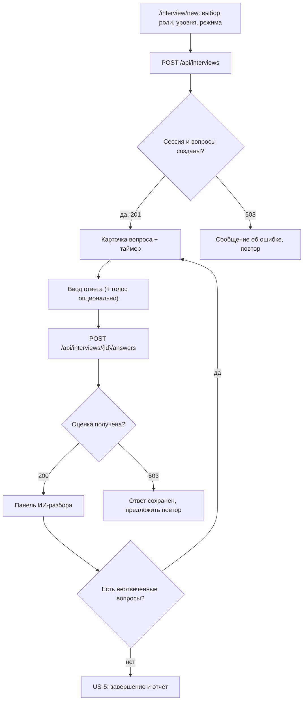
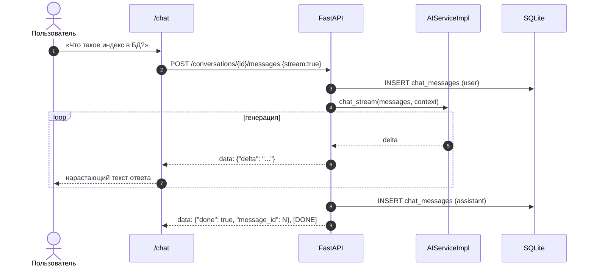

# 03. Пользовательские сценарии

**Проект:** «Интеллектуальный тренажёр для подготовки к собеседованиям»
**Версия документа:** 1.0
**Связанные документы:** [Техническое задание](01-ТЗ.md), [Архитектура](02-Архитектура.md), [API-контракт](API.md), [Тестирование](05-Тестирование.md)

## 1. Соглашения

Документ описывает пользовательские сценарии (user stories) с основными и
альтернативными потоками. Для каждого сценария указаны: актор, предусловия,
триггер, основной поток, альтернативные и исключительные потоки, постусловия,
задействованные эндпоинты и страницы интерфейса.

Обозначения потоков:

* **AF-n** — альтернативный поток (штатное отклонение с успешным исходом);
* **EF-n** — исключительный поток (ошибка, отказ, ограничение).

Единые правила для всех сценариев:

* все запросы, кроме регистрации и входа, выполняются с заголовком
  `Authorization: Bearer <token>`; при `401` клиент очищает токен и переводит
  пользователя на `/login`;
* коды справочников: `roles` — `backend`, `frontend`, `qa`, `data`, `devops`,
  `general`; `levels` — `intern`, `junior`, `middle`, `senior`;
  `modes` — `mixed`, `theory`, `code`;
* даты приходят в формате ISO 8601 (UTC без таймзоны), идентификаторы — целые числа;
* текущий режим ИИ (`live`/`offline`) отображается в интерфейсе и означает:
  `live` — ответы формирует внешняя языковая модель, `offline` — встроенный
  локальный движок. Для пользователя оба режима дают полный набор функций.

### 1.1. Акторы

| Актор | Описание |
|---|---|
| Пользователь (соискатель) | Основной актор; готовится к собеседованию, проходит сессии, читает разборы |
| ИИ-сервис (`AIService`) | Внутренний актор: Live- или Offline-движок, генерирует вопросы, оценивает ответы, ведёт чат, делает ревью |
| Внешний LLM-провайдер | Внешняя система (OpenAI-совместимый API / Ollama), используется только в режиме `live` |
| Браузер | Среда выполнения SPA; предоставляет Web Speech API как резервный голосовой ввод |

### 1.2. Сводная карта сценариев

| ID | Сценарий | Страница SPA | Ключевые эндпоинты |
|---|---|---|---|
| US-1 | Регистрация и вход | `/register`, `/login` | `POST /api/auth/register`, `POST /api/auth/login`, `GET /api/auth/me` |
| US-2 | Настройка профиля и цели подготовки | `/profile` | `GET/PUT /api/profile`, `GET /api/meta` |
| US-3 | Прохождение собеседования | `/interview/new`, `/interview/:id` | `POST /api/interviews`, `POST /api/interviews/{id}/answers` |
| US-4 | Разбор ошибок и работа над слабыми местами | `/interview/:id` | `POST /api/interviews/{id}/answers`, `POST /api/interviews/{id}/questions/next` |
| US-5 | Завершение сессии и итоговый отчёт | `/interview/:id` | `POST /api/interviews/{id}/finish` |
| US-6 | Чат-консультация по теории | `/chat` | `/api/chat/conversations…` (включая SSE) |
| US-7 | Задача по коду и ИИ-ревью | `/code` | `POST /api/code/tasks`, `POST /api/code/tasks/{id}/review`, `GET /api/code/history` |
| US-8 | Аналитика прогресса | `/` (дашборд) | `GET /api/analytics/overview` |
| US-9 | Работа с историей собеседований | `/history`, `/interview/:id` | `GET /api/interviews`, `GET/DELETE /api/interviews/{id}` |
| US-10 | Голосовой ввод ответа | `/interview/:id` | `POST /api/voice/transcribe` (+ Web Speech API) |
| US-11 | Проверка состояния ИИ | `/profile`, шапка приложения | `GET /api/ai/health`, `GET /api/health` |

---

## US-1. Регистрация и вход

**Актор:** пользователь.
**Предусловия:** приложение доступно, пользователь не аутентифицирован.
**Триггер:** пользователь открывает `/register` или `/login`.
**Постусловия:** пользователь аутентифицирован, JWT сохранён на клиенте,
доступны защищённые разделы.

**Основной поток (регистрация):**

1. Пользователь открывает `/register` и вводит имя, email, пароль.
2. SPA валидирует поля локально и отправляет `POST /api/auth/register`
   (`email`, `password`, `full_name`).
3. Сервер нормализует email (`strip().lower()`), проверяет формат и отсутствие
   дубликата.
4. Сервер хеширует пароль PBKDF2-SHA256 (120 000 итераций, случайная соль),
   создаёт запись `users` и возвращает `201` с `access_token`, `token_type: "bearer"`
   и объектом `user`.
5. SPA сохраняет токен в `localStorage`, запоминает пользователя и перенаправляет
   на дашборд `/`.

**Альтернативный поток AF-1.1 — вход существующего пользователя:**

1. Пользователь открывает `/login`, вводит email и пароль.
2. SPA вызывает `POST /api/auth/login`.
3. Сервер находит пользователя по нормализованному email и сверяет PBKDF2-хеш
   через `hmac.compare_digest`.
4. Возвращается `200` с токеном и `UserOut`; SPA перенаправляет на `/`.
5. При открытии приложения с сохранённым токеном SPA проверяет его через
   `GET /api/auth/me`; успешный ответ восстанавливает сессию без повторного ввода
   пароля.

**Исключительные потоки:**

| ID | Условие | Реакция системы | Реакция интерфейса |
|---|---|---|---|
| EF-1.1 | Email уже занят | `400 {"detail": "Пользователь с таким email уже зарегистрирован"}` | Сообщение под полем, форма не очищается |
| EF-1.2 | Некорректный email (нет `@` или точки в домене) | `400 {"detail": "Некорректный email"}` | Подсказка о формате |
| EF-1.3 | Пароль короче 6 символов | `422` (валидация Pydantic: `min_length=6`) | Сообщение о минимальной длине |
| EF-1.4 | Неверная пара email/пароль | `401 {"detail": "Неверный email или пароль"}` | Общее сообщение без указания, что именно неверно |
| EF-1.5 | Токен просрочен или отсутствует | `401 {"detail": "Недействительный или просроченный токен"}` / `«Требуется авторизация»` | Очистка токена, переход на `/login` |

**Связанные требования:** FR-1…FR-7, NFR-9, NFR-10, NFR-17.

---

## US-2. Настройка профиля и цели подготовки

**Актор:** пользователь.
**Предусловия:** пользователь аутентифицирован.
**Триггер:** пользователь открывает `/profile`.
**Постусловия:** цель подготовки сохранена и используется при генерации вопросов.

**Основной поток:**

1. SPA загружает `GET /api/meta` (направления с темами и уровнями, уровни,
   режимы, типы вопросов, сложности) и `GET /api/profile`; `UserOut` содержит
   сохранённые `target_role`, `target_level` и `resume_text`, поэтому форма
   открывается с заполненными значениями.
2. Пользователь выбирает направление (например, `backend`) и уровень
   (например, `middle`), при необходимости указывает имя и вставляет текст резюме.
3. SPA отправляет `PUT /api/profile` с заполненными полями.
4. Сервер проверяет код направления по справочнику `ROLE_TITLES`
   (неизвестный код → `400 «Неизвестное направление подготовки»`),
   нормализует уровень, обрезает резюме до 10 000 символов и сохраняет изменения.
5. Возвращается обновлённый `UserOut`; интерфейс подтверждает сохранение.

**Альтернативные потоки:**

* **AF-2.1 — частичное обновление.** Передаётся только часть полей (`full_name`,
  `target_role`, `target_level` или `resume_text`); остальные остаются без
  изменений (`ProfileIn` — все поля необязательны).
* **AF-2.2 — профиль не заполнен.** При первом входе используются значения
  по умолчанию: `target_role = "backend"`, `target_level = "junior"`,
  `resume_text = null`; генерация вопросов работает и без явной настройки.
* **AF-2.3 — очистка резюме.** Передача `resume_text = ""` сбрасывает резюме
  в `null` (обработка `payload.resume_text.strip()[:10_000] or None`),
  и последующие собеседования генерируются без учёта резюме.

**Исключительные потоки:**

| ID | Условие | Реакция |
|---|---|---|
| EF-2.1 | Неизвестный код направления | `400 «Неизвестное направление подготовки»` |
| EF-2.2 | Некорректный уровень (не из литерала `intern`/`junior`/`middle`/`senior`) | `422` (Pydantic) |
| EF-2.3 | Слишком длинное имя (> 255) | `422` |
| EF-2.4 | Слишком длинное резюме | Тихое усечение до 10 000 символов |

**Связанные требования:** FR-8…FR-11, NFR-12, NFR-18.

---

## US-3. Прохождение собеседования

**Актор:** пользователь, ИИ-сервис.
**Предусловия:** пользователь аутентифицирован; при необходимости настроена цель.
**Триггер:** пользователь нажимает «Начать собеседование» на `/interview/new`.
**Постусловия:** создана сессия `interview_sessions` в статусе `in_progress`
с вопросами; пользователь отвечает и получает оценки.

**Основной поток:**

1. Пользователь открывает `/interview/new`; форма подгружает справочники из
   `GET /api/meta`.
2. Пользователь выбирает направление (`role`), уровень (`level`), режим (`mode`),
   количество вопросов (3–15, по умолчанию 5) и до пяти фокус-тем.
3. SPA вызывает `POST /api/interviews` и получает `201` с `SessionDetail`:
   метаданные сессии и массив `questions` с готовыми формулировками.
4. Пользователь отвечает на первый вопрос: вводит текст и (опционально)
   использует таймер и голосовой ввод (см. US-10).
5. SPA вызывает `POST /api/interviews/{id}/answers` с `question_id`, `text`,
   `time_spent_sec`.
6. Сервер проверяет сессию (владелец, статус `in_progress`), находит вопрос,
   сохраняет (или перезаписывает) ответ, вызывает ИИ-оценку.
7. Возвращается `AnswerResult`: `answer` и `evaluation` (балл 0–10, критерии
   `correctness`, `completeness`, `depth`, `clarity`, сильные стороны, пробелы,
   эталонный ответ, рекомендация, уточняющий вопрос).
8. SPA показывает панель разбора и предлагает перейти к следующему вопросу.
9. Шаги 4–8 повторяются для остальных вопросов; по завершении — US-5.

**Альтернативные потоки:**

* **AF-3.1 — ИИ недоступен при создании сессии.** Если Live-движок недоступен
  и Offline-движок не смог подготовить вопросы (крайний случай), сервер
  дополняет набор из встроенного банка `pick_questions(...)`. Если вопросов
  не удалось получить совсем, возвращается `503 «Не удалось подготовить вопросы
  собеседования»`; SPA предлагает повторить попытку.
* **AF-3.2 — режим `code`.** В сессию попадают вопросы типа `code` с полями
  `starter_code` и `language`; SPA показывает заготовку кода в редакторе.
* **AF-3.3 — режим `theory`.** В сессию попадают только теоретические вопросы.
* **AF-3.4 — фокус-темы.** Если выбраны темы (`focus_topics`), генератор и
  банк отдают им приоритет; при отсутствии подходящих вопросов набор
  добирается из остальных тем направления.
* **AF-3.5 — оценка в офлайн-режиме.** Если внешняя модель недоступна, оценку
  формирует Offline-движок; интерфейс явно показывает бейдж `offline`,
  чтобы пользователь понимал природу обратной связи.

**Исключительные потоки:**

| ID | Условие | Реакция |
|---|---|---|
| EF-3.1 | Число вопросов вне диапазона 3–15 | `422` (Pydantic `ge=3, le=15`) |
| EF-3.2 | Неизвестный код роли/уровня/режима | Нормализация: роль → `backend`, уровень → `junior`; режим — `422`, если не из литерала |
| EF-3.3 | Ошибка ИИ-оценки | `503 «ИИ-оценка временно недоступна: …»`; текст ответа сохранён, повторная отправка пересчитает оценку |
| EF-3.4 | Пустой ответ | `400 «Ответ не может быть пустым»` |
| EF-3.5 | Вопрос из другой сессии | `400 «Вопрос не относится к этому собеседованию»` |
| EF-3.6 | Чужая/несуществующая сессия | `404 «Собеседование не найдено»` |

**Бизнес-правила:** число вопросов в сессии фиксируется при создании; на один
вопрос — один ответ (`answers.question_id` unique); `time_spent_sec` ограничен
сутками; балл и критерии обрезаются до диапазона 0–10 при сохранении.

**Связанные требования:** FR-12…FR-21, NFR-2, NFR-5, NFR-16.

---

## US-4. Разбор ошибок и работа над слабыми местами

**Актор:** пользователь, ИИ-сервис.
**Предусловия:** в сессии есть хотя бы один оценённый ответ.
**Триггер:** пользователь изучает панель разбора или нажимает «Ещё вопрос по слабой теме».
**Постусловия:** пользователь понял ошибку, получил эталон и дополнительный
вопрос по слабой теме.

**Основной поток:**

1. После отправки ответа SPA показывает панель разбора: общий балл, четыре
   критерия в виде шкал, списки `strengths` и `gaps`, эталонный ответ
   `ideal_answer`, рекомендацию `recommendation`, уточняющий вопрос
   `follow_up_question` (если есть).
2. Пользователь сравнивает свой ответ с эталоном, изучает пробелы и рекомендацию.
3. Пользователь нажимает «Ещё вопрос по слабой теме»; SPA вызывает
   `POST /api/interviews/{id}/questions/next`.
4. Сервер вычисляет темы со средним баллом ниже 6,5 (до трёх), запрашивает
   адаптивный вопрос у ИИ с исключением уже заданных формулировок, сохраняет
   вопрос в сессию, увеличивает `question_count` и возвращает `201 QuestionOut`.
5. SPA добавляет вопрос в очередь и показывает его пользователю.

**Альтернативные потоки:**

* **AF-4.1 — повторный ответ.** Пользователь возвращается к отвеченному вопросу
  и отправляет новый ответ. Сервер перезаписывает `answers.text` и
  `time_spent_sec`, удаляет прежнюю запись `evaluations` и создаёт актуальную
  оценку; панель обновляется. Вторая запись ответа не создаётся.
* **AF-4.2 — уточняющий вопрос.** Если в оценке есть `follow_up_question`,
  SPA предлагает ответить на него как на новый аспект темы (вопрос отображается
  как подсказка к разбору).
* **AF-4.3 — нет слабых тем.** Если средние оценки по всем темам не ниже 6,5,
  адаптивный вопрос подбирается по остальным темам направления — сессия
  продолжается без искусственного «понижения» сложности.
* **AF-4.4 — офлайн-подбор.** При недоступности ИИ вопрос подбирается из банка
  с учётом слабых тем; пользователь получает вопрос без задержки.

**Исключительные потоки:**

| ID | Условие | Реакция |
|---|---|---|
| EF-4.1 | Сессия уже завершена | `400 «Собеседование уже завершено»` |
| EF-4.2 | Достигнут максимум 30 вопросов | `400 «Достигнут максимум вопросов в сессии»` |
| EF-4.3 | Банк и ИИ не дали вопроса | `503 «Не удалось подобрать вопрос»` |
| EF-4.4 | Адаптивный вопрос дублирует заданный | Исключается параметром `exclude` (сравнение по нормализованному тексту) |

**Связанные требования:** FR-19, FR-21, FR-22, NFR-5.

---

## US-5. Завершение сессии и итоговый отчёт

**Актор:** пользователь, ИИ-сервис.
**Предусловия:** в сессии есть хотя бы один ответ с оценкой; сессия в статусе
`in_progress`.
**Триггер:** пользователь нажимает «Завершить».
**Постусловия:** сессия переведена в `completed`, сохранён отчёт, доступна
аналитика.

**Основной поток:**

1. SPA вызывает `POST /api/interviews/{id}/finish`.
2. Сервер проверяет сессию и наличие оценённых ответов, рассчитывает длительность
   (`finished_at - started_at`).
3. ИИ-сервис строит отчёт: средний балл, вердикт, сильные стороны, пробелы,
   рекомендации, оценки по темам.
4. Сервер обрезает итоговый балл до 0–10, сохраняет `report` (JSON) и
   `answered_count`, `duration_sec`, выставляет `status = "completed"`,
   `finished_at`, `duration_sec`.
5. Возвращается `SessionDetail` с `report`; SPA переходит на экран отчёта
   `/interview/:id/report` и показывает итоговый балл, вердикт, темы,
   рекомендации и кнопку «К аналитике».
6. Пользователь может удалить сессию или открыть её позже из истории (US-9).

**Альтернативные потоки:**

* **AF-5.1 — повторное завершение.** Если сессия уже `completed`, возвращается
  сохранённый `SessionDetail` без пересчёта отчёта (идемпотентность).
* **AF-5.2 — отчёт без внешней модели.** Отчёт формирует Offline-движок
  (агрегат по темам, вердикт по шкале).
* **AF-5.3 — локальный расчёт при отказе обоих движков.** Роутер применяет
  детерминированный `_local_report`: средние по темам, вердикт по шкале
  (≥8 — «отличный», ≥6 — «хороший», ≥4 — «базовый», иначе «начальный»),
  до трёх слабых тем и рекомендации. Пользователь получает отчёт в любом случае.

**Исключительные потоки:**

| ID | Условие | Реакция |
|---|---|---|
| EF-5.1 | Нет ни одного оценённого ответа | `400 «Ответьте хотя бы на один вопрос»` |
| EF-5.2 | Чужая/несуществующая сессия | `404 «Собеседование не найдено»` |
| EF-5.3 | Ошибка сохранения | Транзакция откатывается, сессия остаётся `in_progress`, SPA предлагает повторить |

**Связанные требования:** FR-23…FR-25, NFR-6.

---

## US-6. Чат-консультация по теории

**Актор:** пользователь, ИИ-сервис.
**Предусловия:** пользователь аутентифицирован.
**Триггер:** пользователь открывает `/chat` и отправляет сообщение.
**Постусловия:** сообщения сохранены, ответ получен (стримингом или целиком).

**Основной поток:**

1. SPA загружает список диалогов `GET /api/chat/conversations`.
2. Пользователь создаёт диалог `POST /api/chat/conversations` (заголовок можно
   не указывать) и получает `201 ConversationOut`.
3. Пользователь открывает диалог: `GET /api/chat/conversations/{id}/messages`
   отдаёт историю сообщений.
4. Пользователь вводит вопрос; SPA отправляет
   `POST /api/chat/conversations/{id}/messages` с `content` и `stream: true`.
5. Сервер сохраняет сообщение пользователя, запускает потоковую генерацию и
   передаёт `text/event-stream`:
   `data: {"delta": ...}` → `data: {"done": true, "message_id": N}` → `data: [DONE]`.
6. SPA склеивает дельты и показывает ответ по мере поступления, индицируя
   состояние «печатает».
7. Полный текст ответа сохраняется как `chat_messages` с `role = "assistant"`;
   `updated_at` диалога обновляется, `message_count` учитывает обе реплики.

**Альтернативные потоки:**

* **AF-6.1 — нестриминговый запрос.** При `stream: false` сервер возвращает
  `ChatTurnOut` с `user_message` и `assistant_message` целиком.
* **AF-6.2 — автоназвание диалога.** Если заголовок не задан, он формируется
  по первому сообщению пользователя (в интерфейсе отображается в списке диалогов).
* **AF-6.3 — офлайн-ответ.** При недоступности Live-движка ответ
  формирует Offline-движок из базы знаний по ключевым словам; поток делится
  на фрагменты по предложениям, поэтому интерфейс не меняет поведения.
* **AF-6.4 — удаление диалога.** `DELETE /api/chat/conversations/{id}` → `204`,
  диалог и сообщения удаляются каскадно.

**Исключительные потоки:**

| ID | Условие | Реакция |
|---|---|---|
| EF-6.1 | Пустое сообщение (`""`) | `422` (Pydantic `min_length=1`) |
| EF-6.2 | Сообщение из одних пробелов | `400 «Сообщение не может быть пустым»` |
| EF-6.3 | Сообщение длиннее 8 000 символов | `422` |
| EF-6.4 | Чужой/несуществующий диалог | `404 «Диалог не найден»` |
| EF-6.5 | Ошибка во время стриминга | Событие `data: {"error": "..."}`, поток закрывается; сообщение пользователя сохранено, повторная отправка возможна |
| EF-6.6 | Ошибка нестримингового ответа | `503 «Чат-ассистент временно недоступен. Попробуйте ещё раз.»`; сообщение пользователя не сохраняется (транзакция откатывается) |

**Детали реализации:** список диалогов поддерживает `limit` (по умолчанию 50,
максимум 200) и `offset`, сортировка — по времени обновления; история для
промпта — последние 20 сообщений; имя диалога автоматически формируется по
первому сообщению, если не задано при создании.

**Связанные требования:** FR-26…FR-30, NFR-4, NFR-12.

---

## US-7. Задача по коду и ИИ-ревью

**Актор:** пользователь, ИИ-сервис.
**Предусловия:** пользователь аутентифицирован.
**Триггер:** пользователь открывает `/code` и нажимает «Сгенерировать задачу».
**Постусловия:** задача и ревью сохранены, доступны в истории.

**Основной поток:**

1. Пользователь выбирает тему (например, «Алгоритмы и структуры данных»),
   язык (`python`, `javascript`, `typescript`, `java`, `c++`, `sql` — по умолчанию
   `python`) и сложность (`easy`/`medium`/`hard`).
2. SPA вызывает `POST /api/code/tasks` и получает `201 CodeTaskOut`:
   `title`, `description`, `starter_code`, `hints`.
3. Пользователь пишет решение в редакторе (textarea с моноширинным шрифтом и
   нумерацией строк), при необходимости раскрывает подсказки.
4. SPA отправляет `POST /api/code/tasks/{id}/review` с текстом решения.
5. Сервер передаёт код ИИ-сервису; ревью **не исполняет** код, а анализирует
   его как текст.
6. Возвращается `CodeReviewOut`: `score` 0–10, `verdict`, `correctness_notes`,
   список `issues` с важностью (`critical`/`major`/`minor`/`nit`), `improved_code`,
   `time_complexity`, `space_complexity`.
7. SPA показывает оценку, замечания с цветовой маркировкой, улучшенный вариант
   и оценки сложности; сохранённое ревью доступно через `GET /api/code/history`.

**Альтернативные потоки:**

* **AF-7.1 — тема не задана.** Тема берётся из цели профиля (`target_role`) или
  из значений по умолчанию.
* **AF-7.2 — офлайн-ревью.** При недоступности Live-движка работает
  эвристический разбор: обработка крайних случаев, именование, признаки
  сложности, статический поиск заглушек (`pass`, `TODO`), шаблон улучшенного
  кода.
* **AF-7.3 — просмотр истории.** `GET /api/code/history` возвращает прошлые
  ревью с пагинацией; пользователь открывает сохранённый разбор без повторной
  отправки.

**Исключительные потоки:**

| ID | Условие | Реакция |
|---|---|---|
| EF-7.1 | Пустой код | `422` (Pydantic `min_length=1`); пробельный код — `400 «Код решения не может быть пустым»` |
| EF-7.2 | Код длиннее 40 000 символов | `422` |
| EF-7.3 | Неподдерживаемый язык | `422` (литерал `CodeTaskIn.language`) |
| EF-7.4 | Чужая/несуществующая задача | `404 «Задача не найдена»` |
| EF-7.5 | Ошибка ИИ-ревью | `503 «ИИ временно недоступен: код-ревью не выполнено.»`; интерфейс предлагает повторить отправку |
| EF-7.6 | Ошибка генерации задачи | `503` с пояснением или `503 «ИИ вернул некорректную задачу»` при пустом ответе модели |

**Связанные требования:** FR-31…FR-35, NFR-13.

---

## US-8. Аналитика прогресса

**Актор:** пользователь.
**Предусловия:** есть хотя бы одна сессия (в идеале — завершённая).
**Триггер:** пользователь открывает дашборд `/`.
**Постусловия:** пользователь видит объективную картину прогресса и слабые темы.

**Основной поток:**

1. SPA вызывает `GET /api/analytics/overview`.
2. Сервер агрегирует данные пользователя: количество сессий и завершённых сессий,
   средний и лучший балл, число отвеченных вопросов, стрик по дням.
3. Возвращаются `weak_topics` (средний балл < 6,5, до 5 тем),
   `strong_topics` (≥ 7,0, до 5), полный `topic_stats`, `difficulty_stats`,
   `score_history` (до 20 точек) и `recent_sessions` (до 5 последних).
4. SPA отображает карточки метрик, линейный график динамики, прогресс-бары
   слабых тем и список последних сессий.
5. Пользователь нажимает на слабую тему и переходит к профилю/новой сессии
   с фокусом на этой теме.

**Альтернативные потоки:**

* **AF-8.1 — нет данных.** Все счётчики равны 0, списки пусты; интерфейс
  показывает пустое состояние и CTA «Начать собеседование».
* **AF-8.2 — только незавершённые сессии.** `completed_sessions = 0`,
  `avg_score = 0.0`, `best_score = 0.0`, `score_history` пуст; метрики по
  ответам при этом рассчитываются (если ответы есть).
* **AF-8.3 — стрик.** Если активность была сегодня или вчера, стрик считается
  с соответствующего дня; при пропуске более одного дня — 0.

**Исключительные потоки:**

| ID | Условие | Реакция |
|---|---|---|
| EF-8.1 | Нет токена | `401`, переход на `/login` |
| EF-8.2 | Ошибка БД | `500` с общим сообщением; SPA показывает уведомление |

**Связанные требования:** FR-36…FR-39, NFR-20.

---

## US-9. Работа с историей собеседований

**Актор:** пользователь.
**Предусловия:** есть хотя бы одна сессия.
**Триггер:** пользователь открывает `/history`.
**Постусловия:** пользователь просмотрел или удалил прошлую сессию.

**Основной поток:**

1. SPA вызывает `GET /api/interviews?limit=20&offset=0`.
2. Сервер отдаёт `{items: SessionSummary[], total}`: статус, балл, число
   вопросов, число ответов, время начала и длительность.
3. Пользователь выбирает сессию → `GET /api/interviews/{id}` → `SessionDetail`
   с вопросами, ответами, оценками и отчётом.
4. Пользователь изучает разборы, отчёт, темы.

**Альтернативные потоки:**

* **AF-9.1 — пагинация.** При большом количестве сессий SPA увеличивает
  `offset` (максимум `limit = 100`).
* **AF-9.2 — удаление.** `DELETE /api/interviews/{id}` → `204`; сессия,
  её вопросы, ответы и оценки удаляются каскадно, список обновляется.
* **AF-9.3 — незавершённая сессия.** Статус `in_progress` отображается
  отдельно; пользователь может продолжить её (переход на `/interview/:id`).

**Исключительные потоки:**

| ID | Условие | Реакция |
|---|---|---|
| EF-9.1 | Чужая/несуществующая сессия | `404 «Собеседование не найдено»` |
| EF-9.2 | Некорректные `limit`/`offset` | `422` (Pydantic `Query(ge=…)`) |

**Связанные требования:** FR-15…FR-17.

---

## US-10. Голосовой ввод ответа

**Актор:** пользователь, браузер. Дополнительно (на уровне API) — ИИ-сервис.
**Предусловия:** пользователь проходит сессию, открыт вопрос.
**Триггер:** пользователь нажимает кнопку микрофона.
**Постусловия:** текст ответа заполнен распознанной речью.

**Основной поток (интерфейс — Web Speech API браузера):**

1. Пользователь нажимает кнопку микрофона; SPA запускает распознавание
   встроенным Web Speech API (`ru-RU`) и показывает индикацию записи.
2. Распознанный фрагмент по мере готовности подставляется в поле ответа;
   пользователь может отредактировать текст.
3. Пользователь завершает запись; сценарий US-3 продолжается (отправка ответа).

**Дополнительный поток уровня API — серверное распознавание:**

1. Клиент (интеграция или сценарий с серверным распознаванием) отправляет аудио
   (webm/wav/mp3) на `POST /api/voice/transcribe` (`multipart/form-data`,
   поле `file`).
2. Сервер передаёт аудио Live-движку (`/audio/transcriptions`, Whisper).
3. Возвращается `{"text": "распознанный текст"}`.

**Альтернативные потоки:**

* **AF-10.1 — браузер не поддерживает Web Speech API.** Кнопка микрофона
  неактивна, SPA показывает пояснение и остаётся в режиме текстового ввода;
  для интеграций при этом доступен серверный `POST /api/voice/transcribe`.
* **AF-10.2 — ручной ввод.** Пользователь отказывается от голоса и печатает
  ответ; сценарий US-3 продолжается без изменений.
* **AF-10.3 — микрофон запрещён.** Браузер не даёт доступ к микрофону;
  SPA показывает сообщение о необходимости разрешения и остаётся в режиме
  текстового ввода.

**Исключительные потоки (серверный эндпоинт):**

| ID | Условие | Реакция |
|---|---|---|
| EF-10.1 | Провайдер не поддерживает распознавание / не настроен | `503` с рекомендацией использовать Web Speech API |
| EF-10.2 | Пустой аудиофайл | `400 «Пустой аудиофайл»` |
| EF-10.3 | Файл больше 25 МБ | `400 «Аудиофайл слишком большой (максимум 25 МБ).»` |
| EF-10.4 | Неподдерживаемый формат | `400 «Неподдерживаемый формат аудио. Отправьте webm, wav или mp3.»` |

**Связанные требования:** FR-44, NFR-22.

---

## US-11. Проверка состояния ИИ

**Актор:** пользователь.
**Предусловия:** приложение запущено.
**Триггер:** пользователь открывает профиль/шапку приложения.
**Постусловия:** пользователь понимает, каким движком формируются ответы.

**Основной поток:**

1. SPA вызывает `GET /api/ai/health`.
2. Сервер проверяет Live-движок; если он доступен — возвращает
   `{provider, model, mode: "live", available: true, message}`.
3. Иначе возвращается состояние офлайн-движка: `mode: "offline"`,
   `available: true` (офлайн-движок всегда работоспособен), понятное сообщение.
4. SPA отображает бейдж `live`/`offline` рядом с профилем.

**Альтернативные потоки:**

* **AF-11.1 — деградация во время работы.** Пользователь продолжает работу;
  при следующем сбое внешней модели запросы автоматически обслуживаются
  офлайн-движком, интерфейс обновляет бейдж при следующем обращении к health.
* **AF-11.2 — общий health.** `GET /api/health` возвращает `status: "ok"`,
  `app`, `version`, `ai_provider`, `ai_mode` — используется для мониторинга и
  быстрой диагностики при запуске.

**Исключительные потоки:**

| ID | Условие | Реакция |
|---|---|---|
| EF-11.1 | ИИ-слой не инициализирован | `GET /api/health` отдаёт `200` (значения по умолчанию `offline`); `GET /api/ai/health` отдаёт `200` с офлайн-заглушкой (`provider="offline"`, `available=true`) |

**Связанные требования:** FR-41…FR-43, FR-45, NFR-21.

---

## 2. Сквозные сценарии

### 2.1. Сценарий «подготовка за неделю» (композитный)

| Шаг | Действие | Результат |
|---|---|---|
| 1 | Регистрация (US-1), заполнение профиля и резюме (US-2) | Цель: `backend` / `middle` |
| 2 | Собеседование из 5 вопросов в режиме `mixed` (US-3) | Первый срез знаний, оценки 0–10 |
| 3 | Разбор ошибок, адаптивные вопросы по слабым темам (US-4) | Понимание конкретных пробелов |
| 4 | Чат по слабым темам (US-6) | Уточнение теории в диалоге |
| 5 | Задача по коду и ревью (US-7) | Практика и разбор стиля/сложности |
| 6 | Завершение сессии и отчёт (US-5) | Итоговый вердикт и рекомендации |
| 7 | Дашборд (US-8) | Динамика, слабые темы, стрик |
| 8 | Повторные сессии через 1–2 дня (US-3…US-5) | Рост среднего балла и закрытие слабых тем |

### 2.2. Сквозной сценарий без сети (демонстрационный)

1. `AI_API_KEY` пуст → `GET /api/ai/health` возвращает `mode: "offline"`.
2. Регистрация, профиль, создание собеседования — вопросы подбираются из банка.
3. Ответ → оценка Offline-движком (4 критерия, сильные стороны, пробелы, эталон).
4. Адаптивный вопрос, завершение, отчёт — всё работает.
5. Чат и код-ревью — офлайн-база знаний и эвристики.
6. Аналитика показывает реальные агрегаты по сохранённым данным.

Этот сценарий — основной для приёмки (AC-3, AC-6 из [ТЗ](01-ТЗ.md)) и для
демонстрации без затрат на внешний API.

### 2.3. Сквозной сценарий с живой моделью

1. Задан `AI_API_KEY` (и при необходимости `AI_BASE_URL`, `AI_MODEL`) →
   `GET /api/ai/health` возвращает `mode: "live"`, `available: true`.
2. Вопросы генерируются моделью с учётом роли, уровня, режима, фокус-тем и резюме.
3. Оценка содержит развёрнутые `strengths`/`gaps`/`ideal_answer`.
4. При таймауте или ошибке провайдера соответствующий запрос обслуживается
   офлайн-движком — пользователь не видит отказа (AF-3.5, AF-5.2).

## 3. Матрица «сценарий → требования»

| Сценарий | Функциональные требования | Нефункциональные |
|---|---|---|
| US-1 | FR-1…FR-7 | NFR-9, NFR-10, NFR-12, NFR-17 |
| US-2 | FR-8…FR-11 | NFR-12, NFR-18 |
| US-3 | FR-12…FR-21 | NFR-1…NFR-5, NFR-12 |
| US-4 | FR-19, FR-21, FR-22 | NFR-5 |
| US-5 | FR-23…FR-25 | NFR-6 |
| US-6 | FR-26…FR-30 | NFR-4, NFR-12 |
| US-7 | FR-31…FR-35 | NFR-13 |
| US-8 | FR-36…FR-39 | NFR-1, NFR-20 |
| US-9 | FR-15…FR-17 | NFR-8 |
| US-10 | FR-44 | NFR-22 |
| US-11 | FR-41…FR-43, FR-45 | NFR-21 |

## 4. Матрица «сценарий → страница интерфейса»

| Страница | Маршрут | Сценарии | Основные данные |
|---|---|---|---|
| Вход | `/login` | US-1 (AF-1.1) | `POST /api/auth/login` |
| Регистрация | `/register` | US-1 | `POST /api/auth/register` |
| Дашборд | `/` | US-8, US-9 (кратко) | `GET /api/analytics/overview`, `GET /api/interviews` |
| Новое собеседование | `/interview/new` | US-3 | `GET /api/meta`, `POST /api/interviews` |
| Прохождение | `/interview/:id` | US-3, US-4, US-5, US-10 | `GET /api/interviews/{id}`, `POST …/answers`, `POST …/questions/next`, `POST …/finish` |
| Отчёт | `/interview/:id/report` | US-5 | `GET /api/interviews/{id}` (поле `report`) |
| Чат | `/chat` | US-6 | `/api/chat/conversations…` |
| Код | `/code` | US-7 | `/api/code/tasks…`, `/api/code/history` |
| История | `/history` | US-9 | `GET /api/interviews`, `DELETE /api/interviews/{id}` |
| Профиль | `/profile` | US-2, US-11 | `GET/PUT /api/profile`, `GET /api/ai/health` |
