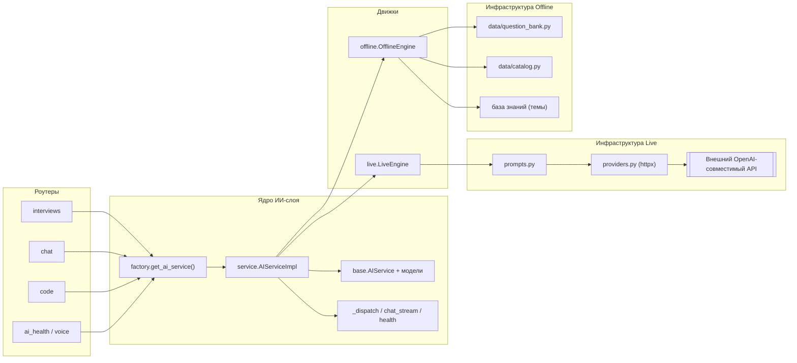
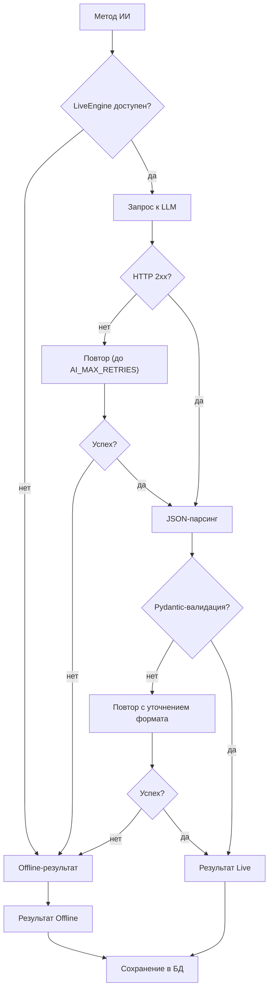

# 04. Пояснительная записка

**Тема:** «Интеллектуальный тренажёр для подготовки к собеседованиям»
**Версия документа:** 1.0
**Связанные документы:** [Техническое задание](01-ТЗ.md), [Архитектура](02-Архитектура.md), [Сценарии](03-Сценарии.md), [API-контракт](API.md), [Тестирование](05-Тестирование.md)

---

## Содержание

1. [Введение](#1-введение)
2. [Анализ предметной области](#2-анализ-предметной-области)
3. [Постановка задачи](#3-постановка-задачи)
4. [Проектирование системы](#4-проектирование-системы)
5. [Реализация](#5-реализация)
6. [ИИ-компонент](#6-ии-компонент)
7. [Тестирование](#7-тестирование)
8. [Развёртывание и эксплуатация](#8-развёртывание-и-эксплуатация)
9. [Заключение](#9-заключение)
10. [Список источников](#10-список-источников)

---

## 1. Введение

### 1.1. Актуальность

Техническое собеседование остаётся основным фильтром при трудоустройстве в
ИТ-отрасль, при этом его результат слабо коррелирует с формальным стажем и
сильно зависит от навыка *отвечать*: структурировать мысль, называть причины и
компромиссы, приводить примеры, укладываться в ожидаемый уровень детализации.
Соискатель часто располагает знаниями, но не имеет возможности проверить, как
эти знания выглядят в формате интервью.

Существующие способы подготовки имеют разрывы:

* **задачники** (LeetCode и аналоги) тренируют решение алгоритмических задач,
  но не оценивают развёрнутые теоретические ответы и не дают методической
  обратной связи по формулировкам;
* **конспекты и видео** пассивны: отсутствует проверка понимания и метрика
  прогресса;
* **универсальные чат-боты** умеют объяснять теорию, но не ведут
  структурированную сессию с вопросами по уровню, не сохраняют историю оценок
  и не сравнивают ответы между собой;
* **менторские платформы** требуют участия человека, что дорого и не
  масштабируется.

Возникает практическая ниша: **автоматизированный тренажёр, который ведёт
полноценную сессию собеседования, оценивает развёрнутые ответы по формальным
критериям, объясняет ошибки и показывает динамику подготовки** — при этом
работающий без платных внешних сервисов, чтобы им можно было пользоваться в
учебном и демонстрационном контексте.

Дополнительным фактором актуальности является зрелость больших языковых моделей
(LLM): они способны генерировать предметные вопросы под уровень и оценивать
свободный текст по заданной рубрике. Это позволяет построить тренажёр без
собственной ML-модели, используя LLM как сменный компонент через
OpenAI-совместимый интерфейс.

### 1.2. Цель работы

Спроектировать и реализовать веб-приложение «Интеллектуальный тренажёр для
подготовки к собеседованиям», которое:

1. имитирует техническое интервью по выбранному направлению и уровню;
2. автоматически оценивает развёрнутые ответы по четырём критериям, объясняет
   ошибки и показывает эталонный ответ;
3. формирует итоговый отчёт по сессии и аналитику прогресса;
4. поддерживает вспомогательные режимы: чат по теории, задачи по коду с
   ИИ-ревью, голосовой ввод;
5. сохраняет полную работоспособность при недоступности внешней LLM за счёт
   встроенного офлайн-движка.

### 1.3. Задачи

| № | Задача | Результат |
|---|---|---|
| 1 | Проанализировать предметную область и существующие решения, определить нишу | Раздел 2, таблица сравнения аналогов |
| 2 | Сформулировать функциональные и нефункциональные требования | [01-ТЗ.md](01-ТЗ.md) |
| 3 | Спроектировать архитектуру, модель данных и API-контракт | [02-Архитектура.md](02-Архитектура.md), [API.md](API.md) |
| 4 | Реализовать бэкенд: аутентификацию, собеседования, оценку, отчёт, аналитику | `backend/app` |
| 5 | Реализовать ИИ-слой с двумя движками и автоматическим fallback | `backend/app/ai` |
| 6 | Реализовать пользовательский интерфейс | `frontend/` |
| 7 | Наполнить банк вопросов и подготовить демо-данные | `app/data/question_bank.py`, `scripts/seed_demo.py` |
| 8 | Покрыть систему тестами и выполнить приёмку | `backend/tests`, [05-Тестирование.md](05-Тестирование.md) |
| 9 | Подготовить комплект проектной документации | `README.md`, `docs/*` |

### 1.4. Объект, предмет и методы

* **Объект исследования** — процесс подготовки соискателя к техническому
  собеседованию.
* **Предмет исследования** — методы автоматической генерации вопросов,
  формализации и автоматической оценки развёрнутых ответов, а также визуализации
  прогресса в веб-приложении.
* **Методы:** системный анализ предметной области, сравнительный анализ
  аналогов, объектно-ориентированное и компонентное проектирование, прототипирование,
  экспериментальная проверка (сценарное и автоматизированное тестирование),
  анализ и обобщение результатов.

### 1.5. Практическая значимость

1. Соискатель получает тренажёр с объективной балльной оценкой и разбором
   ошибок, пригодный для регулярной самостоятельной подготовки.
2. Преподаватель/наставник получает инструмент для демонстрации методики
   оценки ответов и для организации практических занятий.
3. Проект реализует **воспроизводимый** сценарий работы ИИ без платного API,
   что важно для учебных заведений и демонстраций: офлайн-движок не зависит от
   сети, стоимости и изменчивости внешних моделей.
4. Архитектура с провайдер-агностичным ИИ-слоем позволяет заменить модель или
   подключить локальную (Ollama) без изменения прикладного кода.

### 1.6. Структура документа

Раздел 2 анализирует предметную область и аналоги. Раздел 3 формализует
постановку задачи. Раздел 4 описывает проектные решения. Раздел 5 — реализацию
подсистем. Раздел 6 детально рассматривает ИИ-компонент: промпт-инжиниринг,
JSON-схемы, fallback и метрики качества. Раздел 7 обобщает тестирование,
раздел 8 — развёртывание, раздел 9 — итоги, раздел 10 — источники.

---

## 2. Анализ предметной области

### 2.1. Структура технического собеседования

Техническое собеседование обычно состоит из блоков:

| Блок | Проверяемое качество | Формат ответа |
|---|---|---|
| Теория языка и платформы | Глубина понимания, знание деталей | Развёрнутый текст |
| Базы данных и SQL | Понимание моделей данных, оптимизации | Текст, примеры запросов |
| Алгоритмы и структуры данных | Аналитическое мышление, оценка сложности | Рассуждение, код |
| Системный дизайн / архитектура | Компромиссы, масштабирование | Структурированный рассказ |
| Практика кода | Корректность, стиль, крайние случаи | Код + пояснение |
| Поведенческие вопросы (HR) | Коммуникация, мотивация, командная работа | История по схеме STAR |

Из этой структуры следуют требования к тренажёру: вопросы должны иметь **тему**
и **сложность**, соответствовать **уровню** (intern/junior/middle/senior) и
**направлению** (backend, frontend, QA, аналитика, DevOps, HR), ответы — быть
**свободным текстом**, а оценка — **многокритериальной** и объяснимой.

### 2.2. Анализ существующих решений

Для сравнения выбраны четыре класса решений: международные задачные платформы
(LeetCode), российские тренажёры собеседований («Тинькофф Тренажёр»),
универсальные LLM-ассистенты (ChatGPT) и образовательные платформы с проверкой
кода (Exercism). Сравнение выполнено по десяти признакам, существенным для
проекта.

| Критерий | LeetCode | «Тинькофф Тренажёр» | ChatGPT | Exercism | **Разрабатываемый тренажёр** |
|---|---|---|---|---|---|
| Генерация вопросов под уровень/направление | Каталог задач, фильтры | Каталог вопросов по направлениям | По запросу, без структуры сессии | Каталог упражнений | Генерация ИИ под роль, уровень, режим, фокус-темы и резюме; fallback на банк |
| Теоретические вопросы со свободным ответом | Практически нет | Есть, с эталонными ответами | Есть, но без рубрики | Нет | Есть, с рубрикой из 4 критериев |
| Автоматическая оценка развёрнутого ответа | Нет | Частично (самопроверка) | Текстовая, неформализованная | Автотесты для кода | Формализованная: балл 0–10, 4 критерия, strengths/gaps |
| Объяснение ошибок и эталон | Разбор решений сообщества | Эталонный ответ | Объяснение в диалоге | Обсуждение решения | `ideal_answer`, `gaps`, `recommendation`, `follow_up_question` |
| Итоговый отчёт по сессии | Нет | Нет | Нет | Нет | Отчёт с вердиктом, темами и рекомендациями |
| Аналитика прогресса | Статистика задач | Ограниченная | Отсутствует | Трекинг упражнений | Дашборд: динамика, слабые/сильные темы, стрик |
| Чат по теории | Нет | Нет | Да, ядро продукта | Нет | Да, встроенный, с историей диалогов и SSE |
| Ревью кода без исполнения | Только запуск тестов | Нет | Да, по запросу | Автотесты + ментор | Да, с оценкой и замечаниями по важности |
| Работа без внешней сети/платного API | Нет (нужен интернет) | Нет | Нет | Нет | Да, офлайн-движок; Live — опционально |
| Русскоязычный интерфейс и контент | Частично | Да | Да | Частично | Да, полностью |
| Открытый исходный код и локальное развёртывание | Нет | Нет | Нет | Да | Да |
| Стоимость для пользователя | Подписка | Бесплатно | Подписка/лимиты | Бесплатно | Бесплатно (опционально — стоимость токенов LLM) |

**Выводы из сравнения:**

1. Задачные платформы сильны в проверке кода, но не решают задачу оценки
   *свободного текстового ответа* — а именно она составляет большую часть
   технического интервью.
2. Российские тренажёры дают качественный контент, но не формируют
   персонализированную оценку ответа и аналитику прогресса по темам.
3. Универсальные LLM-ассистенты обладают нужной «интеллектуальной» основой, но
   не имеют структуры сессии, рубрики оценки, хранения истории и метрик — их
   ответы невоспроизводимы и не сравнимы между попытками.
4. Ни одно из рассмотренных решений не обеспечивает одновременного выполнения
   требований: русскоязычный интерфейс, формализованная многокритериальная
   оценка, аналитика, офлайн-режим, локальное развёртывание и открытый код.

Таким образом, разрабатываемая система занимает нишу «структурированный
ИИ-тренажёр с объяснимой оценкой и аналитикой, работающий в демонстрационном
окружении без внешних платных сервисов».

### 2.3. Ограничения существующих подходов к автоматической оценке

Автоматическая оценка свободного текста — принципиально недетерминированная
задача. Известны три подхода:

| Подход | Суть | Достоинства | Ограничения |
|---|---|---|---|
| Эталонное сравнение | Сравнение с эталонным текстом (n-граммы, эмбеддинги) | Воспроизводимость | Плохо работает при свободной формулировке, требует эталонов на каждый вопрос |
| Рубрики и эвристики | Формальные признаки: покрытие ключевых пунктов, структура, длина, примеры | Полностью объяснимо, воспроизводимо | Грубее оценивает смысл, чувствительно к формулировкам |
| LLM-оценка по рубрике | Модель выставляет критерии по инструкции | Понимает смысл, даёт развёрнутый разбор | Недетерминизм, зависимость от провайдера, возможные «галлюцинации» |

В проекте применён **гибридный** подход: LLM-оценка как основной путь и
эвристическая рубрика как обязательный fallback. Это обеспечивает и качество
обратной связи, и воспроизводимость демонстрации.

### 2.4. Выводы по разделу

Анализ показывает, что целевому пользователю нужен инструмент, который
*структурирует* подготовку (сессия, уровни, темы), *объясняет* оценку
(критерии, пробелы, эталон) и *измеряет* прогресс (аналитика), при этом не
зависит от конкретного внешнего провайдера. Эти выводы легли в основу требований
и архитектуры.

---

## 3. Постановка задачи

### 3.1. Содержательная постановка

Даны:

* пользователь с целевым направлением подготовки и уровнем;
* сессия собеседования, определяемая набором параметров
  `(role, level, mode, question_count, focus_topics)`;
* банк вопросов с эталонными пунктами ответа;
* ИИ-сервис, способный генерировать вопросы и оценивать тексты по рубрике
  (Live-движок — внешняя LLM; Offline-движок — детерминированные эвристики).

Требуется построить систему, которая для каждой сессии:

1. формирует ровно `question_count` вопросов, соответствующих параметрам;
2. для каждого ответа пользователя вычисляет оценку
   `Evaluation = (score, criteria, strengths, gaps, ideal_answer, recommendation, follow_up_question)`,
   где `score ∈ [0, 10]`, а `criteria = {correctness, completeness, depth, clarity}`
   — каждое значение в `[0, 10]`;
3. по множеству оценённых ответов строит отчёт сессии
   `Report = (overall_score, verdict, strengths, gaps, recommendations, topic_scores)`;
4. накапливает агрегированную статистику по темам, сложностям и времени,
   достаточную для дашборда;
5. при отказе ИИ сохраняет работоспособность сценария (fallback);
6. не раскрывает данные одного пользователя другому.

### 3.2. Формализация оценки ответа

Пусть:

* `q` — вопрос с темой `t(q)`, сложностью `d(q)` и множеством эталонных пунктов
  `P(q) = {p₁, …, pₖ}`;
* `a` — текст ответа пользователя;
* `u = (role, level)` — контекст пользователя.

Тогда ИИ-оценка — отображение

```text
E: (q, a, u) → (score, crit, strengths, gaps, ideal, reco, follow)
где crit = (c_correct, c_complete, c_depth, c_clarity), каждая ∈ [0, 10],
    score ∈ [0, 10] — интегральная оценка, согласованная с crit.
```

Требование согласованности означает: интегральный балл не должен противоречить
частным критериям (например, при низкой `correctness` общий балл не может быть
максимальным). В Live-режиме согласованность задаётся инструкцией промпта и
проверяется валидацией диапазонов; в Offline-режиме — единой формулой
эвристической оценки.

Отчёт по сессии — агрегат над множеством оценённых ответов `A`:

```text
report.overall_score = round(mean{score(a) | a ∈ A}, 1)
topic_scores[t]      = round(mean{score(a) | t(q_a) = t}, 1)
weak_topics          = темы с topic_scores[t] < 6.5 (до 3–5)
strong_topics        = темы с topic_scores[t] ≥ 7.0 (до 5)
verdict              = пороговая функция от overall_score
```

Пороги `6.5` и `7.0` выбраны как границы между «требует повторения» и
«уверенный уровень» по десятибалльной шкале и используются согласованно
в отчёте сессии, аналитике и адаптивном подборе вопросов.

### 3.3. Функциональные и нефункциональные требования

Полный перечень — в [01-ТЗ.md](01-ТЗ.md) (FR-1…FR-48, NFR-1…NFR-32). Ключевые
для проектирования:

* генерация вопросов под роль/уровень/режим/фокус/резюме;
* оценка ответа с четырьмя критериями и объяснением;
* адаптивный дополнительный вопрос по слабым темам;
* отчёт сессии и аналитика прогресса;
* чат с потоковой выдачей и историей;
* код-ревью без исполнения кода;
* прозрачный fallback Live → Offline;
* изоляция данных пользователей и защита секретов;
* развёртывание одним процессом со статикой SPA.

### 3.4. Ограничения и допущения

Ограничения зафиксированы в [01-ТЗ.md](01-ТЗ.md) §6: отсутствие исполнения кода,
отсутствие миграций, синхронная обработка в одном процессе, зависимость качества
Live-оценки от внешней модели, передача резюме в промпт, русскоязычная
ориентация. Допущения: пользователь имеет современный браузер; при использовании
Live-режима доступен OpenAI-совместимый endpoint; SQLite достаточна для
персонального и учебного использования.

---

## 4. Проектирование системы

### 4.1. Архитектурные решения

Принят **модульный монолит** с тремя логическими уровнями и выделенным
ИИ-слоем (подробно — в [02-Архитектура.md](02-Архитектура.md)). Обоснование:

* единый артефакт развёртывания критичен для демонстрации и учебного
  использования;
* модульность внутри монолита сохраняет границы ответственности и позволяет
  позже вынести ИИ-слой в отдельный сервис (контракт `AIService` уже это
  допускает);
* выделение ИИ-слоя в отдельный модуль с фабрикой исключает «утечку» деталей
  провайдера в роутеры.

### 4.2. Модель данных

Спроектированы девять сущностей, отражающих предметную область:

| Сущность | Смысл | Ключевые связи |
|---|---|---|
| `users` | Пользователь и цель подготовки | 1 : N к сессиям, диалогам, задачам |
| `interview_sessions` | Сессия собеседования | N : 1 к пользователю; 1 : N к вопросам, ответам, оценкам |
| `questions` | Вопрос сессии | N : 1 к сессии; 1 : 0..1 к ответу |
| `answers` | Ответ пользователя | 1 : 1 к вопросу; 1 : 0..1 к оценке |
| `evaluations` | ИИ-оценка ответа | 1 : 1 к ответу; N : 1 к вопросу и сессии |
| `chat_conversations` | Диалог с ассистентом | N : 1 к пользователю; 1 : N к сообщениям |
| `chat_messages` | Сообщение диалога | N : 1 к диалогу |
| `code_tasks` | Задача по коду | N : 1 к пользователю; 1 : N к отправкам |
| `code_submissions` | Решение и ревью | N : 1 к задаче и пользователю |

Проектные решения по модели:

1. **Один ответ на вопрос** — ограничение `unique` на `answers.question_id`
   реализует семантику «пересдать вопрос», не раздувая историю.
2. **Одна актуальная оценка на ответ** — `unique` на `evaluations.answer_id`;
   при повторной отправке старая оценка удаляется, новая создаётся в той же
   транзакции.
3. **Дублирование `session_id`/`user_id`** в `answers` и `evaluations` —
   денормализация ради простых агрегатов аналитики и проверок владельца.
4. **JSON-снимки** (`report`, `criteria`, `review`) — сохранение результата ИИ
   «как есть»: отчёт не пересчитывается при каждом открытии, история оценок
   остаётся согласованной.
5. **`expected_points` у вопроса** — эталонные пункты ответа, которые
   используются и Live-промптом, и офлайн-эвристиками; это связующее звено
   между контентом и оценкой.

### 4.3. Проектирование API

API спроектирован как REST с префиксом `/api`, JSON-телами, JWT-аутентификацией
и единым форматом ошибок `{"detail": "..."}`. Полный контракт — [API.md](API.md).
Принципы:

* **ресурсная адресация**: `/interviews`, `/chat/conversations`, `/code/tasks`;
* **явные коды состояния**: `201` при создании, `204` при удалении, `400` для
  нарушений бизнес-правил, `401`/`404`/`422`/`503` для типовых категорий;
* **пагинация** через `limit`/`offset` и конверт `{items, total}`;
* **идемпотентность** там, где это важно: повторный `finish` возвращает
  сохранённый результат, повторная отправка ответа перезаписывает, а не создаёт
  дубль;
* **SSE** для стриминга чата (`text/event-stream`, события `delta`/`done`/`[DONE]`,
  ошибка — событие `error`).

### 4.4. Проектирование ИИ-слоя

Ключевое проектное решение — контракт `AIService` (`app/ai/base.py`) с десятью
операциями и общими Pydantic-моделями результатов, плюс фабрика
`get_ai_service()` и диспетчер `AIServiceImpl` с двумя движками. Схема
взаимодействия:

```text
роутер ──► get_ai_service() ──► AIServiceImpl._dispatch(method, **kwargs)
                                      │
                        ┌─────────────┴──────────────┐
                        │                            │
                   LiveEngine                   OfflineEngine
                (LLM через httpx,            (банк вопросов,
                 промпты, JSON)                эвристики, база знаний)
```

Почему фабрика, а не инъекция в каждый роутер: ленивая потокобезопасная
инициализация даёт один экземпляр на процесс, упрощает логирование и позволяет
тестам сбрасывать кэш (`reset_ai_service()`).

Почему fallback на уровне диспетчера, а не в каждом методе: политика «любой сбой
Live → Offline» должна быть единой; дублирование этой логики в десяти методах
повышает риск расхождений.

### 4.5. Проектирование пользовательских потоков

Сценарии спроектированы вокруг «петли обучения»: **сессия → оценка → разбор →
адаптивный вопрос → отчёт → аналитика**. Подробные потоки и альтернативы —
в [03-Сценарии.md](03-Сценарии.md). Для каждого сценария определены
предусловия, основной поток, альтернативные и исключительные потоки, а также
матрица «сценарий → требования» для трассировки.

### 4.6. Обоснование выбора технологий

Сводная таблица решений и альтернатив приведена в
[02-Архитектура.md](02-Архитектура.md) §7. Кратко:

* **FastAPI + Pydantic v2** — валидация, OpenAPI «из коробки», SSE и
  интеграция с `TestClient` для тестов;
* **SQLAlchemy 2.0** — типизированные модели и каскады, переносимость SQLite →
  PostgreSQL;
* **SQLite** — нулевая настройка, файловая переносимость, пригодность для
  демо и тестов;
* **JWT + PBKDF2 на stdlib** — отсутствие внешних зависимостей для
  аутентификации;
* **httpx** — единый клиент для обычных и потоковых запросов к любому
  OpenAI-совместимому API;
* **React + TypeScript + Vite + Tailwind** — строгая типизация контракта,
  быстрая сборка, адаптивный интерфейс без тяжёлого UI-фреймворка.

---

## 5. Реализация

### 5.1. Структура кода

```text
backend/app/
├─ main.py         — создание FastAPI, роутеры, CORS, SPA, /api/health
├─ config.py       — Settings (pydantic-settings), ai_enabled
├─ db.py           — engine, SessionLocal, Base, init_db(), get_db()
├─ models.py       — 9 ORM-моделей, utcnow()
├─ schemas.py      — Pydantic-схемы, литеральные коды
├─ security.py     — PBKDF2-SHA256, JWT HS256
├─ deps.py         — get_current_user (HTTPBearer)
├─ routers/        — auth, users, meta, interviews, analytics, chat, code, ai_health, voice
├─ ai/             — base, factory, service, live, offline, prompts, providers
└─ data/           — catalog, question_bank
```

Приложение создаётся фабрикой `create_app()`, что упрощает тестирование и
позволяет в будущем поднимать несколько экземпляров с разными настройками.
`init_db()` вызывается и в `lifespan`, и в `create_app()` — идемпотентно, чтобы
таблицы существовали и при запуске без ASGI-lifespan (например, в тестах с
`TestClient`).

### 5.2. Аутентификация и разграничение доступа

1. `POST /api/auth/register` нормализует email, проверяет формат и дубликат,
   хеширует пароль PBKDF2-SHA256 (120 000 итераций, соль 16 байт), сохраняет
   пользователя и возвращает JWT.
2. `POST /api/auth/login` сверяет хеш через `hmac.compare_digest`
   (защита от timing-атак) и выдаёт токен.
3. JWT создаётся `jwt.encode` с HS256, полезной нагрузкой
   `{sub, iat, exp, type}`, сроком `ACCESS_TOKEN_EXPIRE_MINUTES` (7 дней).
4. `get_current_user` извлекает токен через `HTTPBearer(auto_error=False)`,
   декодирует, находит пользователя по `sub`; любая ошибка → `401` с
   `WWW-Authenticate: Bearer`.
5. Все запросы к пользовательским сущностям фильтруются по `user_id`;
   чужие объекты → `404` (не раскрывается факт существования).

### 5.3. Жизненный цикл собеседования

**Создание сессии.** `create_interview` нормализует роль и уровень, ограничивает
фокус-темы пятью, запрашивает вопросы у ИИ-сервиса, отбрасывает пустые
формулировки, при нехватке добирает `pick_questions(...)`, обрезает до
`question_count` и сохраняет сессию и вопросы в одной транзакции. Если вопросов
получить не удалось совсем — `503`. Признак источника сохраняется в
`questions.source`.

**Ответ и оценка.** `submit_answer` проверяет статус сессии, принадлежность
вопроса, непустоту текста; выполняет upsert ответа (`question.answer` —
отношение 1 : 1), удаляет прежнюю оценку, вызывает
`evaluate_answer(question, answer_text, role, level)`, обрезает балл и критерии
до `[0, 10]`, сохраняет `Evaluation`, обновляет `duration_sec` и фиксирует
транзакцию. Ошибка ИИ → `503` без частично записанных данных.

**Адаптивный вопрос.** `next_question` вычисляет средние баллы по темам из
`session.answers`, выбирает темы ниже 6,5 (до трёх), передаёт их как
`weak_topics`, исключает уже заданные тексты, ограничивает сессию 30 вопросами
и сохраняет новый вопрос с `order_index = len(questions)`.

**Завершение.** `finish_interview` собирает `items` из оценённых ответов,
вызывает `build_report`, обрезает `overall_score`, сохраняет отчёт с
`answered_count` и `duration_sec`, переводит статус в `completed`. При отказе
ИИ-сервиса применяется детерминированный локальный расчёт `_local_report`.

### 5.4. Аналитика

`GET /api/analytics/overview` вычисляет:

* `sessions_count` — все сессии пользователя, `completed_sessions` — завершённые
  с непустым `overall_score`;
* `avg_score` и `best_score` — по завершённым сессиям;
* `questions_answered` — число оценок, соединённых с ответами пользователя;
* `topic_stats` — средние баллы по темам, сортировка по убыванию;
  `weak_topics` — темы со средним < 6,5 (до 5, по возрастанию),
  `strong_topics` — со средним ≥ 7,0 (до 5);
* `difficulty_stats` — средние баллы по сложностям;
* `score_history` — последние 20 точек `(date, score)` по завершённым сессиям;
* `streak_days` — число подряд идущих дней с оценёнными ответами; отсчёт
  начинается с сегодняшнего дня, если сегодня была активность, иначе с вчерашнего;
  разрыв в один день и более обнуляет стрик;
* `recent_sessions` — до пяти последних сессий.

Такой набор даёт одновременно «срез» (средние, лучший результат) и «тренд»
(история), а слабые темы напрямую питают адаптивный подбор вопросов и
рекомендации в отчёте.

### 5.5. Чат и потоковая передача

Чат реализован как диалоги с сообщениями; отправка возвращает либо пару
сообщений (`stream: false`), либо SSE-поток (`stream: true`). Поток формируется
генератором дельт: Live-движок отдаёт фрагменты внешней модели; при ошибке до
первой дельты или обрыве посреди потока диспетчер переходит на офлайн-поток
(база знаний по ключевым словам, выдача по предложениям). По завершении полный
текст сохраняется как сообщение ассистента, обновляется `updated_at` диалога,
`message_count` учитывает обе реплики.

### 5.6. Задачи по коду и ревью

`POST /api/code/tasks` создаёт задачу (тема, язык, сложность), сохраняет
`starter_code` и `hints`; `POST /api/code/tasks/{id}/review` передаёт код
ИИ-сервису, который анализирует его **как текст** (без исполнения) и возвращает
оценку, вердикт, замечания четырёх уровней важности, улучшенный вариант и
оценки сложности. Результат сохраняется в `code_submissions.review` (JSON) и
доступен в истории.

### 5.7. Пользовательский интерфейс

SPA на React 18 + TypeScript (Vite 8, TailwindCSS 3.4) реализует одиннадцать
маршрутов: `/login`, `/register`, `/` (дашборд), `/interview/new`,
`/interview/:id` (прохождение), `/interview/:id/report` (итоговый отчёт),
`/chat`, `/code`, `/history`, `/profile` и страницу 404. Особенности:

* единый API-клиент (`src/lib/api.ts`) с обработкой `401` (сброс токена,
  редирект на `/login`) и извлечением `detail` из ошибок, включая 422;
* TypeScript-типы (`src/lib/types.ts`), соответствующие схемам контракта;
* контекст аутентификации (`AuthContext`), контекст уведомлений (`ToastContext`)
  и защищённые маршруты (`ProtectedRoute`, `PublicOnlyRoute`);
* переиспользуемые компоненты: `Layout` (сайдбар/мобильное меню),
  `EvaluationPanel` (балл, четыре критерия, сильные стороны, пробелы, эталон),
  `CodeEditor` (нумерация строк), `SessionCard`, `StatCard`, `ScoreRing`,
  `ProgressBar`, `Modal`, `Skeleton`, `EmptyState` и другие;
* потоковый чат через `fetch` + `ReadableStream` с обработкой `delta`, `done`,
  `[DONE]` и `error`, индикацией «печатает» и списком диалогов;
* голосовой ввод — Web Speech API (`ru-RU`) с аккуратным fallback: если браузер
  не поддерживает распознавание или доступ к микрофону запрещён, кнопка
  неактивна и показывается пояснение;
* бейдж режима ИИ (`live`/`offline`), получаемый из `GET /api/ai/health`;
* тёмная тема, адаптивность mobile-first, состояния загрузки и пустые состояния.

### 5.8. Обработка ошибок и устойчивость

Реализованы три уровня устойчивости:

1. **Уровень ИИ-сервиса** — fallback Live → Offline для всех операций;
   потоковый чат сохраняет частичный ответ и не рвёт сессию.
2. **Уровень роутера** — локальные детерминированные расчёты при отказе
   ИИ-сервиса (подбор вопросов из банка, локальный отчёт), `503` с русским
   сообщением там, где без ИИ операция невозможна (оценка ответа).
3. **Уровень приложения** — идемпотентная инициализация БД, каскадное удаление,
   защита от path traversal при раздаче SPA, единый формат ошибок без утечки
   внутренних деталей.

---

## 6. ИИ-компонент

### 6.1. Роль языковой модели в системе

LLM используется для четырёх классов операций:

| Операция | Вход | Выход (Pydantic-модель) |
|---|---|---|
| Генерация вопросов | роль, уровень, режим, число, фокус-темы, резюме | `list[GeneratedQuestion]` |
| Оценка ответа | вопрос с `expected_points`, текст ответа, роль, уровень | `EvaluationResult` |
| Отчёт сессии | список пар «вопрос — оценка», роль, уровень, длительность | `SessionReportData` |
| Задача и код-ревью | тема, язык, сложность / код, условие задачи | `CodeTaskData` / `CodeReviewData` |
| Чат | история сообщений, контекст | поток текста |

Во всех случаях LLM выступает «экспертным оценщиком по рубрике», а не источником
истины: результат валидируется схемой и при необходимости заменяется офлайн-
результатом.

### 6.2. Архитектура ИИ-слоя



### 6.3. Промпт-инжиниринг

Промпты хранятся отдельно от логики (`app/ai/prompts.py`) и построены по единой
схеме:

1. **Роль и контекст** — «Ты — опытный технический интервьюер, оценивающий
   ответ кандидата уровня `{level}` на позицию `{role}`».
2. **Задача** — что именно требуется сделать (сгенерировать вопросы, оценить
   ответ, собрать отчёт, сделать ревью).
3. **Входные данные** — вопрос, эталонные пункты `expected_points`, текст
   ответа, тема, сложность.
4. **Рубрика** — определение каждого критерия (`correctness`, `completeness`,
   `depth`, `clarity`), шкала 0–10 и требование согласованности интегрального
   балла с критериями.
5. **Формат вывода** — строгий JSON с перечислением ключей и типов; запрет на
   текст вне JSON.
6. **Ограничения** — не выдумывать факты, не выходить за диапазон 0–10,
   писать на русском, не повторять вопросы, учитывать уровень кандидата.

Фактическая структура инструкции для оценки (фрагмент `app/ai/prompts.py`):

```text
Ты — строгий, но доброжелательный эксперт-интервьюер. Ты оцениваешь ответ
кандидата на техническом собеседовании по четырём критериям (каждый 0–10):
  correctness  — фактическая правильность: нет ли ошибок и опасных упрощений;
  completeness — полнота: все ли ключевые пункты раскрыты;
  depth        — глубина: понимание причин, механизмов, компромиссов;
  clarity      — ясность и структура: логичность, терминология, примеры.

Правила: 0–2 — пусто/не по теме; 3–4 — базовые ошибки; 5–6 — верно, но неполно;
7–8 — уверенный ответ; 9–10 — эталон. Не завышай за «воду» и длину.
score — интегральная оценка, согласованная со средним критериев.
strengths и gaps — по 1–4 конкретных пункта; ideal_answer — 2–5 предложений;
recommendation — конкретный следующий шаг; follow_up_question — уточняющий
вопрос или null.

ВАЖНО: верни ТОЛЬКО валидный JSON-объект — без пояснений, markdown-разметки
и текста до/после JSON. Строки в двойных кавычках, весь текст на русском.
```

В пользовательское сообщение подставляются роль и уровень кандидата, вопрос
(тема, тип, сложность), до восьми эталонных пунктов `expected_points`,
заготовка кода (для задач, до 1 200 символов), текст ответа (до 12 000 символов)
и JSON-схема ожидаемого результата.

Генерация вопросов дополнительно учитывает режим: в `theory` — только теория;
в `mixed` при четырёх и более вопросах — 1–2 задачи с кодом; в `code` — не менее
половины задач. В промпт включаются приоритетные фокус-темы (до 8), фрагмент
резюме (до 1 500 символов, без цитирования) и список исключений (до 30 уже
заданных вопросов). Требования к контенту: вопросы проверяют понимание,
`expected_points` — 3–5 конкретных тезисов, тип и сложность — строго из
допустимых значений.

Такая структура решает три задачи: снижает вариативность формата, задаёт
единую рубрику для всех вопросов и делает оценку объяснимой для пользователя.
Общее требование «только JSON» вынесено в константу `JSON_ONLY` и повторяется
в каждом системном промпте.

### 6.4. JSON-схемы и валидация

Все результаты ИИ описаны Pydantic-моделями в `app/ai/base.py`:

| Модель | Поля |
|---|---|
| `GeneratedQuestion` | `text`, `topic`, `difficulty`, `type`, `expected_points`, `starter_code`, `language` |
| `EvaluationResult` | `score`, `criteria`, `strengths`, `gaps`, `ideal_answer`, `recommendation`, `follow_up_question` |
| `SessionReportData` | `overall_score`, `verdict`, `strengths`, `gaps`, `recommendations`, `topic_scores` |
| `CodeTaskData` | `title`, `description`, `topic`, `language`, `difficulty`, `starter_code`, `hints` |
| `CodeReviewData` | `score`, `verdict`, `correctness_notes`, `issues[]`, `improved_code`, `time_complexity`, `space_complexity` |
| `AIHealthInfo` | `provider`, `model`, `mode`, `available`, `message` |

Механизм валидации:

1. модель просят вернуть JSON (при поддержке провайдером — с
   `response_format={"type": "json_object"}`);
2. полученный текст обрабатывается `extract_json`: снимаются обёртки
   ```` ```json … ``` ````, при необходимости выделяется первый корректный
   JSON-объект/массив; затем `json.loads`;
3. данные валидируются соответствующей Pydantic-моделью; необязательные поля
   имеют значения по умолчанию, поэтому частичный ответ не ломает сценарий;
4. при ошибке парсинга/валидации выполняется повтор с уточнением формата;
5. если и повтор не дал валидного результата — исключение `LLMError`, которое
   `AIServiceImpl` перехватывает и передаёт управление Offline-движку.

Повторы HTTP-запросов выполняются только для восстановимых статусов
(`408`, `409`, `425`, `429`, `500`, `502`, `503`, `504`) и сетевых ошибок;
число попыток ограничено `AI_MAX_RETRIES`, задержка нарастает, таймаут задан
`AI_TIMEOUT_SEC`. Для серверов, не поддерживающих `response_format`, клиент
мягко откатывается к обычному режиму без JSON-флага.

Дополнительно роутеры нормализуют значения: балл и критерии обрезаются до
`[0, 10]`, `overall_score` округляется до одного знака, пустые формулировки
вопросов отбрасываются.

### 6.5. Fallback-стратегия



Каскад надёжности образует четыре контура:

| Контур | Инструмент | Что защищает |
|---|---|---|
| 1 | Таймауты и повторы в HTTP-клиенте (`AI_TIMEOUT_SEC`, `AI_MAX_RETRIES`) | Сетевые сбои, медленный провайдер |
| 2 | Повтор с уточнением формата | Невалидный JSON |
| 3 | `_dispatch` → Offline-движок | Любое исключение Live-движка |
| 4 | Локальные расчёты в роутерах (банк вопросов, `_local_report`) | Отказ обоих движков |

Итог: **пользовательский сценарий не имеет единой точки отказа в ИИ**.
Единственная операция, где fallback невозможен, — распознавание речи; она
деградирует в браузерный Web Speech API.

### 6.6. Офлайн-движок: эвристики

Offline-движок — не имитация, а самостоятельный методический компонент:

* **Банк вопросов** — структурированные вопросы по шести направлениям с
  темами, сложностями, типами и эталонными пунктами `expected_points`
  (версия 1.0: 163 вопроса, 18 задач по коду, 39 тем); подбор `pick_questions`
  учитывает роль (включая общие/HR-вопросы), близость сложности к целевой для
  уровня (`LEVEL_TARGET`: intern/junior → easy, middle → medium, senior → hard),
  фокус-темы, ограничение «не более двух вопросов на тему» и исключение уже
  заданных.
* **Оценка ответа** — эвристическая рубрика с прозрачными формулами.
* **Отчёт** — агрегация по темам, вердикт по порогам, рекомендации по слабым
  темам.
* **Чат** — база знаний из 15 тем (Python и базовые типы, GIL, генераторы,
  ООП, SQL, индексы, транзакции, HTTP, REST, React, хуки, тестирование, Git,
  Docker, алгоритмы) с определением темы по ключевым словам и выдачей по
  предложениям.
* **Код-ревью** — признаки качества: обработка крайних случаев, именование,
  глубина вложенности циклов, оценка сложности по структуре кода, баланс
  скобок, статический поиск заглушек (`pass`, `TODO`), шаблон улучшенного
  решения; не более 10 замечаний.

**Формулы эвристической оценки.** Пусть для вопроса с эталонными пунктами
`P = {p₁, …, pₖ}` и ответа `a`:

* `coverage(p) = |{ключевые основы p, найденные в a}| / |{ключевые основы p}|`;
* `coverage = mean(coverage(p))` по всем пунктам (пункт считается раскрытым при
  `coverage(p) ≥ 0,5`);
* `length_factor = min(1; |a| в словах / expected)`, где
  `expected = (30 + 15·k) · level_factor`, `level_factor` = 0,8 / 1,0 / 1,15 / 1,3
  для intern / junior / middle / senior;
* признаки `reasoning`, `examples`, `comparison`, `listed`, `structure`
  определяются по маркерам («потому что», «например», «в отличие»,
  нумерованные пункты и т. п.).

Тогда для ответа длиной более трёх слов:

```text
correctness  = 2,0 + 7,0·coverage
completeness = 1,5 + 8,0·(0,7·coverage + 0,3·length_factor)
depth        = 1,5 + 5,5·coverage + 1,0·reasoning + 0,5·examples
               + 0,5·comparison + min(0,5; 0,5·length_factor)
clarity      = 4,0 + 1,5·listed + 1,0·reasoning + 0,5·examples
               + 0,5·structure + 0,5·[|a| ≥ 3 предложений]
               + 0,5·[10 ≤ |a| ≤ 320 слов]
score        = round(mean(correctness, completeness, depth, clarity), 1)
```

Корректировки: для ответов на вопросы типа `code` добавляются бонусы за код с
ветвлениями/циклами/возвратом; ответ короче 10 слов ограничивает
`correctness`, `completeness` и `depth` (не выше 3,0 / 2,5 / 2,5); «водянистый»
ответ (более 60 слов, `coverage < 0,25`, низкая лексическая новизна) получает
штраф −1,5 к `correctness` и `completeness`, −1,0 к `clarity`, −0,5 к `depth`;
слишком длинный ответ без структуры теряет 1,0 к `clarity`; полное покрытие всех
пунктов даёт +0,5 к `correctness` и +1,0 к `completeness`. Все значения
приводятся к `[0, 10]`.

**Отчёт.** `overall_score` — среднее оценок (до 0,1); `topic_scores` — средние
по темам; слабые темы — `< 6,5`, сильные — `≥ 7,0`; вердикт по порогам
`8,0 / 6,5 / 4,5`; в `strengths` и `gaps` — до шести уникальных пунктов с
добавлением тем-лидеров и тем-проблем, в `recommendations` — до четырёх
рекомендаций по слабым темам плюс стратегическая рекомендация по уровню.

Детерминированность офлайн-движка делает его пригодным для автотестов: один и
тот же ответ всегда даёт одну и ту же оценку, что невозможно гарантировать для
Live-режима. Точные формулы и константы сосредоточены в
`backend/app/ai/offline.py` и покрываются юнит-тестами.

### 6.7. Метрики качества ИИ-компонента

Качество ИИ-оценки предлагается измерять по пяти группам метрик.

| Группа | Метрика | Способ измерения | Целевое значение |
|---|---|---|---|
| Согласованность шкалы | Доля оценок, где интегральный балл согласован с критериями (отклонение ≤ 1,5) | Автоматическая проверка по сохранённым `evaluations` | ≥ 95 % |
| Диапазоны и полнота | Доля оценок с заполненными `criteria`, `strengths`, `gaps`, `ideal_answer` в диапазоне 0–10 | Автотесты, `smoke_check.py` | 100 % |
| Воспроизводимость Offline | Совпадение оценки для одного и того же ответа при повторных вызовах | Юнит-тесты `OfflineEngine` | 100 % |
| Устойчивость к сбоям | Доля запросов, обслуженных без ошибки при недоступном Live-движке | Тест с принудительным отключением провайдера | 100 % |
| Латентность | Время ответа офлайн-операций; время до первой дельты чата | Замеры, логи | ≤ 1 с (офлайн), первый фрагмент — без ожидания полного ответа |
| Качество экспертной оценки | Корреляция балла системы с оценкой эксперта на размеченном наборе ответов (Spearman ρ), доля грубых расхождений (|Δ| ≥ 3 балла) | Ручная разметка 50–100 ответов, расчёт корреляции | ρ ≥ 0,7; грубые расхождения ≤ 15 % |

Методика оценки качества экспертной оценки (для Live-режима):

1. Формируется набор из 50–100 ответов разного качества (пустые, частичные,
   полные, с ошибками) на вопросы из банка.
2. Два независимых эксперта выставляют балл 0–10 и отмечают ошибки.
3. Система оценивает те же ответы; считается корреляция Спирмена и
   средняя абсолютная ошибка.
4. Анализируются систематические смещения (например, завышение за длину
   ответа) и корректируется промпт/рубрика.

Такая методика применима и к сравнению движков: Offline-движок служит
воспроизводимым baseline, Live-движок должен превосходить его по корреляции
с экспертом.

### 6.8. Ограничения ИИ-оценки

1. LLM может завышать оценку за объём и уверенный тон ответа — частично
   компенсируется требованием согласованности критериев и рубрикой.
2. Возможны фактические ошибки модели («галлюцинации») в эталонном ответе;
   поэтому `ideal_answer` подаётся как учебная подсказка, а не как источник
   истины.
3. Live-оценка недетерминирована: два прогона могут дать разные баллы, поэтому
   сравнение прогресса корректно прежде всего внутри одного режима.
4. Оценка ограничена текстом: интонация, оговорки и качество речи не
   учитываются (голосовой ввод только транскрибируется).
5. Русскоязычные промпты ориентированы на русский язык; ответы на других
   языках могут оцениваться нестабильно.

Эти ограничения зафиксированы в [01-ТЗ.md](01-ТЗ.md) §6 и должны сообщаться
пользователю в интерфейсе (оценка — тренировочная, не экзаменационная).

### 6.9. Быстродействие и управление задержками

Задержка ИИ-операции определяется одним запросом к модели, поэтому в проекте
предусмотрены механизмы, не позволяющие пользователю ждать неограниченно:

| Механизм | Реализация | Эффект |
|---|---|---|
| Быстрая модель по умолчанию | для `AI_PROVIDER=gemini` выбрана `gemini-3.5-flash-lite` | секунды вместо десятков секунд |
| Управляемые таймауты | `AI_TIMEOUT_SEC=45`, `AI_MAX_RETRIES=1` | ограниченное сверху ожидание |
| Отказ от повторов при квоте | `429` с признаком quota/billing не повторяется | нет трат времени на заведомо неуспешные попытки |
| «Предохранитель» | после сбоя — офлайн на `AI_FAILURE_COOLDOWN_SEC=120` | последующие ответы мгновенные |
| Резервные модели и ключи | `AI_MODEL_FALLBACKS`, `AI_API_KEYS`; классификация 429/401/403/404/503 | при исчерпанной квоте или недоступной модели запрос уходит на следующую связку «ключ+модель» автоматически |
| Кэш health-проверки | 300 с | провайдер не дёргается при каждом открытии страницы |
| Потоковый чат | SSE-дельты | первый токен виден примерно через 0,5 с |

Измеренные значения на реальном ключе Gemini (Flash-Lite) приведены в
[README.md](../README.md); на бесплатном тарифе они подвержены троттлингу
и могут варьироваться.

---

## 7. Тестирование

Полная стратегия, уровни, тест-кейсы и трассировка — в
[05-Тестирование.md](05-Тестирование.md). Кратко:

### 7.1. Уровни тестирования

| Уровень | Объект | Инструменты |
|---|---|---|
| Модульное | Отдельные функции (`security`, `catalog`, `question_bank`, `OfflineEngine`, аналитические расчёты) | pytest |
| Интеграционное | API-эндпоинты через `TestClient`, работа с временной SQLite | pytest + FastAPI TestClient |
| Сквозное | Полный сценарий: регистрация → собеседование → оценка → отчёт → аналитика → чат → код | `scripts/smoke_check.py` |
| Функциональное ручное | Интерфейс, адаптивность, голосовой ввод, отображение режима ИИ | чек-лист в [05-Тестирование.md](05-Тестирование.md) |
| Приёмочное | Критерии AC-1…AC-13 из [01-ТЗ.md](01-ТЗ.md) | прогон чек-листа |

### 7.2. Ключевые проверяемые свойства

1. **Безопасность доступа**: без токена — `401`; чужие сессии, диалоги и
   задачи — `404`.
2. **Корректность бизнес-правил**: число вопросов, повторная отправка ответа,
   завершение без ответов (`400`), повторное завершение идемпотентно.
3. **Валидность ИИ-результатов**: балл и критерии в `[0, 10]`, непустые
   `ideal_answer`, `recommendation`, `verdict`.
4. **Отказоустойчивость**: работа в `offline` без ключа; прозрачный fallback
   при отключённом Live-движке.
5. **Целостность данных**: каскадное удаление, отсутствие дублей ответов и
   оценок.
6. **Контракт**: поля ответов соответствуют [API.md](API.md).

### 7.3. Негативные проверки

Проверяются: некорректный email, короткий пароль, пустой ответ, ответ на
завершённую сессию, вопрос из другой сессии, адаптивный вопрос сверх лимита 30,
пустой код, слишком длинные поля (20 000/40 000/8 000 символов), неверный
`limit`/`offset`, обращение к чужому объекту, недоступный ИИ при оценке (`503`).

### 7.4. Результаты контрольного прогона

| Проверка | Команда | Результат |
|---|---|---|
| Автоматические тесты бэкенда | `pytest -q` (из `backend/`) | **220 тестов пройдено, 0 падений** (130 тестовых функций в 12 модулях, включая параметризованные) |
| Сквозной сценарий API | `python scripts/smoke_check.py` | **26 проверок пройдено, 0 провалено**, код возврата 0 (режим `offline`, изолированная БД) |
| Сборка фронтенда | `npm run build` (из `frontend/`) | Сборка без ошибок TypeScript, артефакты в `backend/app/static` (`index.html`, хэшированные `index-*.js` и `index-*.css`) |
| Согласованность документации | Ревизия `docs/*` | Названия эндпоинтов, таблиц и полей сверены с `docs/API.md` и моделями |

Сквозной прогон подтверждает критерии AC-1, AC-3, AC-5, AC-6, AC-9 из
[01-ТЗ.md](01-ТЗ.md); ручные проверки интерфейса и Live-режима выполняются по
чек-листу [05-Тестирование.md](05-Тестирование.md) §7–§8.

---

## 8. Развёртывание и эксплуатация

### 8.1. Состав поставки

| Компонент | Содержимое |
|---|---|
| Бэкенд | `backend/app` (FastAPI-приложение), `backend/requirements.txt`, `backend/.env.example` |
| Фронтенд | `frontend/` (исходники) → сборка в `backend/app/static` |
| Данные | SQLite `backend/data/app.db` (создаётся автоматически) |
| Скрипты | `backend/scripts/smoke_check.py`, `backend/scripts/seed_demo.py` |
| Тесты | `backend/tests` |
| Документация | `README.md`, `docs/*` |

### 8.2. Сценарий установки

1. Клонирование репозитория.
2. Создание виртуального окружения и установка `backend/requirements.txt`.
3. Копирование `.env.example` → `.env`, указание `SECRET_KEY` (для продакшена —
   сгенерированного), опционально ключа и адреса LLM.
4. `npm install && npm run build` во `frontend/`.
5. (Опционально) `python scripts/seed_demo.py` — демо-данные.
6. Запуск `uvicorn app.main:app --host 127.0.0.1 --port 8000`.

### 8.3. Режимы эксплуатации

| Режим | Настройка | Особенности |
|---|---|---|
| Демонстрационный офлайн | `AI_PROVIDER=offline` или пустой ключ | Без сети и оплаты, детерминированные оценки |
| Продуктивный Live | `AI_PROVIDER=gemini`/`openai`/`ollama`, ключ, модель | Качество и разнообразие от LLM; при сбое — fallback |
| Разработка | `npm run dev` + uvicorn | Vite-прокси `/api`, горячая замена модулей |

### 8.4. Эксплуатационные ограничения и развитие

* Резервное копирование — копия файла SQLite; для перехода на PostgreSQL
  достаточно изменить `DATABASE_URL`.
* Синхронные обработчики и один процесс ограничивают вертикальный рост
  нагрузки; для масштабирования — асинхронный драйвер БД, вынесение статики
  за reverse proxy, горизонтальное размножение экземпляров при переходе на
  общую СУБД.
* Миграции в версии 1.0 отсутствуют (`create_all`); при изменении схемы — ручная
  миграция (ограничение O-4).

### 8.5. Стоимость эксплуатации

Решение не требует платных подписок: все компоненты — с открытым исходным кодом,
развёртывание локальное.

| Компонент | Стоимость | Условие |
|---|---|---|
| Код, зависимости, SQLite | 0 | Локальный запуск |
| Offline-движок | 0 | Без ключа, без сети |
| Live-движок (Gemini, бесплатный тариф) | 0 | Доступ к части моделей (Flash/Flash-Lite) с лимитами запросов |
| Live-движок (платные API) | по тарифу | Не требуется для проекта и демонстрации |
| Хостинг | 0 | Локальный демонстрационный стенд |

При исчерпании квоты (`429`) или ошибке провайдера автоматический fallback
сохраняет работоспособность без затрат; флагманские модели (Gemini 4 Argon) в
бесплатный тариф не входят и для работы тренажёра не нужны.

---

## 9. Заключение

### 9.1. Итоги

В работе спроектирован и реализован интеллектуальный тренажёр для подготовки к
техническим собеседованиям. Достигнуты следующие результаты:

1. **Сформулированы требования** (48 функциональных и 33 нефункциональных),
   зафиксирован контракт API и модель данных; требования трассированы на
   реализацию и тесты.
2. **Реализован бэкенд** на FastAPI с JWT-аутентификацией, SQLAlchemy-моделями,
   девятью таблицами, жизненным циклом собеседования (создание → ответы →
   адаптивные вопросы → отчёт) и аналитикой прогресса.
3. **Реализован ИИ-слой** с провайдер-агностичным контрактом `AIService`,
   Live-движком (OpenAI-совместимый HTTP API, промпты, строгие JSON-схемы,
   потоковый чат, Whisper) и Offline-движком (банк вопросов, эвристики оценки,
   база знаний, эвристическое ревью); выстроен четырёхконтурный fallback.
4. **Реализован пользовательский интерфейс** на React + TypeScript: дашборд,
   прохождение интервью с панелью разбора, потоковый чат, код-ревью, история,
   профиль; интерфейс на русском языке и адаптивен.
5. **Подготовлен контент и демо-данные**: банк из 163 вопросов и 18 задач по
   коду с эталонными пунктами по шести направлениям, демонстрационный аккаунт
   `demo@trainer.ru` с историей сессий, чатов и ревью.
6. **Обеспечена проверяемость**: pytest-набор из 220 проверок, сквозной сценарий
   `smoke_check.py` (26 контрольных точек), критерии приёмки AC-1…AC-13,
   комплект документации.

### 9.2. Практическая ценность

Система закрывает разрыв между «знанием теории» и «умением отвечать»: она
формализует оценку, делает её объяснимой и отслеживает прогресс. Благодаря
обязательному офлайн-движку тренажёр воспроизводим в учебной аудитории, не
требует платных сервисов и сохраняет полный функционал без сети, а
провайдер-агностичный ИИ-слой позволяет подключить любую современную модель.

### 9.3. Направления развития

| Направление | Содержание |
|---|---|
| Персонализация промптов | Учёт резюме и истории слабых тем при генерации (сейчас резюме передаётся, история — частично) |
| Больше направлений и уровней | Расширение справочника и контента, добавление специализаций |
| Миграции БД | Введение Alembic для эволюции схемы без пересоздания |
| Промышленная эксплуатация | PostgreSQL, асинхронный SQLAlchemy, reverse proxy, контейнеризация |
| Оценка качества | Регулярная разметка набора ответов и мониторинг корреляции с экспертом |
| Новые форматы | Диалоговый режим голосом (TTS), парное собеседование, командные сценарии |
| Мультиязычность | Промпты и интерфейс на английском языке |

### 9.4. Вывод

Поставленная цель достигнута: создан работающий тренажёр, сочетающий
структурированный сценарий интервью, объяснимую многокритериальную ИИ-оценку,
итоговую аналитику и устойчивость к отказу внешней модели. Архитектура оставляет
пространство для развития без переработки контракта API и прикладной логики.

---

## 10. Список источников

1. ГОСТ 34.601-90. Информационная технология. Комплекс стандартов на
   автоматизированные системы. Автоматизированные системы. Стадии создания. —
   М.: Стандартинформ.
2. ГОСТ 19.201-78. Единая система программной документации. Техническое
   задание. Требования к содержанию и оформлению. — М.: Стандартинформ.
3. ГОСТ Р 7.0.5-2008. Библиографическая ссылка. Общие требования и правила
   составления. — М.: Стандартинформ.
4. FastAPI Documentation [Электронный ресурс]. — URL: https://fastapi.tiangolo.com
   (дата обращения: 02.11.2026).
5. Pydantic Documentation [Электронный ресурс]. — URL: https://docs.pydantic.dev
   (дата обращения: 02.11.2026).
6. SQLAlchemy 2.0 Documentation [Электронный ресурс]. — URL:
   https://docs.sqlalchemy.org (дата обращения: 02.11.2026).
7. SQLite Documentation [Электронный ресурс]. — URL: https://www.sqlite.org/docs.html
   (дата обращения: 02.11.2026).
8. React Documentation [Электронный ресурс]. — URL: https://react.dev
   (дата обращения: 02.11.2026).
9. Vite Documentation [Электронный ресурс]. — URL: https://vitejs.dev
   (дата обращения: 02.11.2026).
10. Tailwind CSS Documentation [Электронный ресурс]. — URL: https://tailwindcss.com/docs
    (дата обращения: 02.11.2026).
11. Recharts Documentation [Электронный ресурс]. — URL: https://recharts.org
    (дата обращения: 02.11.2026).
12. OpenAPI Specification 3.1.0 [Электронный ресурс]. — URL:
    https://spec.openapis.org/oas/v3.1.0 (дата обращения: 02.11.2026).
13. RFC 7519. JSON Web Token (JWT) / M. Jones, J. Bradley, N. Sakimura. —
    IETF, 2015.
14. RFC 8018. PKCS #5: Password-Based Cryptography Specification Version 2.1 /
    K. Moriarty, B. Kaliski, A. Rusch. — IETF, 2017.
15. OWASP Top 10:2021 [Электронный ресурс]. — URL:
    https://owasp.org/www-project-top-ten/ (дата обращения: 02.11.2026).
16. OpenAI API Reference [Электронный ресурс]. — URL:
    https://platform.openai.com/docs/api-reference (дата обращения: 02.11.2026).
17. Ollama Documentation [Электронный ресурс]. — URL: https://ollama.com/docs
    (дата обращения: 02.11.2026).
18. LeetCode [Электронный ресурс]. — URL: https://leetcode.com
    (дата обращения: 02.11.2026).
19. Тинькофф Тренажёр собеседований [Электронный ресурс]. — URL:
    https://fintech.tinkoff.ru/activities/trainer/ (дата обращения: 02.11.2026).
20. OpenAI ChatGPT [Электронный ресурс]. — URL: https://chat.openai.com
    (дата обращения: 02.11.2026).
21. Exercism [Электронный ресурс]. — URL: https://exercism.org
    (дата обращения: 02.11.2026).
22. MDN Web Docs. Server-sent events [Электронный ресурс]. — URL:
    https://developer.mozilla.org/ru/docs/Web/API/Server-sent_events
    (дата обращения: 02.11.2026).
23. MDN Web Docs. Web Speech API [Электронный ресурс]. — URL:
    https://developer.mozilla.org/ru/docs/Web/API/Web_Speech_API
    (дата обращения: 02.11.2026).
24. Поляков А. Н. Проектирование веб-приложений: учебное пособие. — СПб.:
    Питер, 2023. — 352 с.
25. Фаулер М. Архитектура корпоративных программных приложений. — М.:
    Вильямс, 2020. — 544 с.
26. Кнут Д. Э. Искусство программирования. Т. 3. Сортировка и поиск. — М.:
    Вильямс, 2019. — 832 с.
